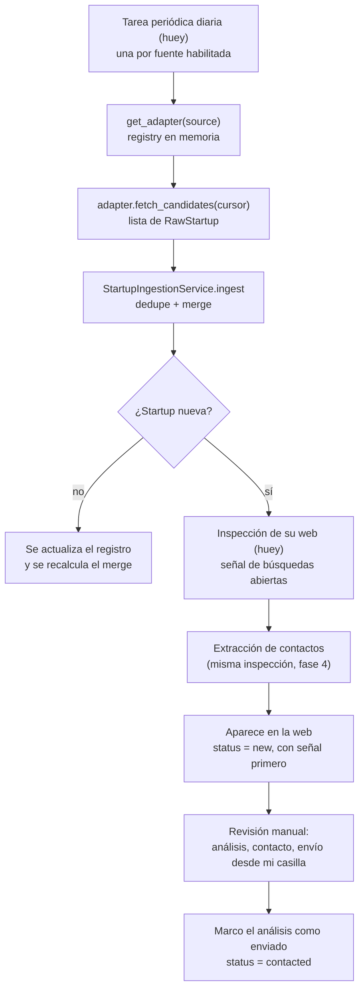
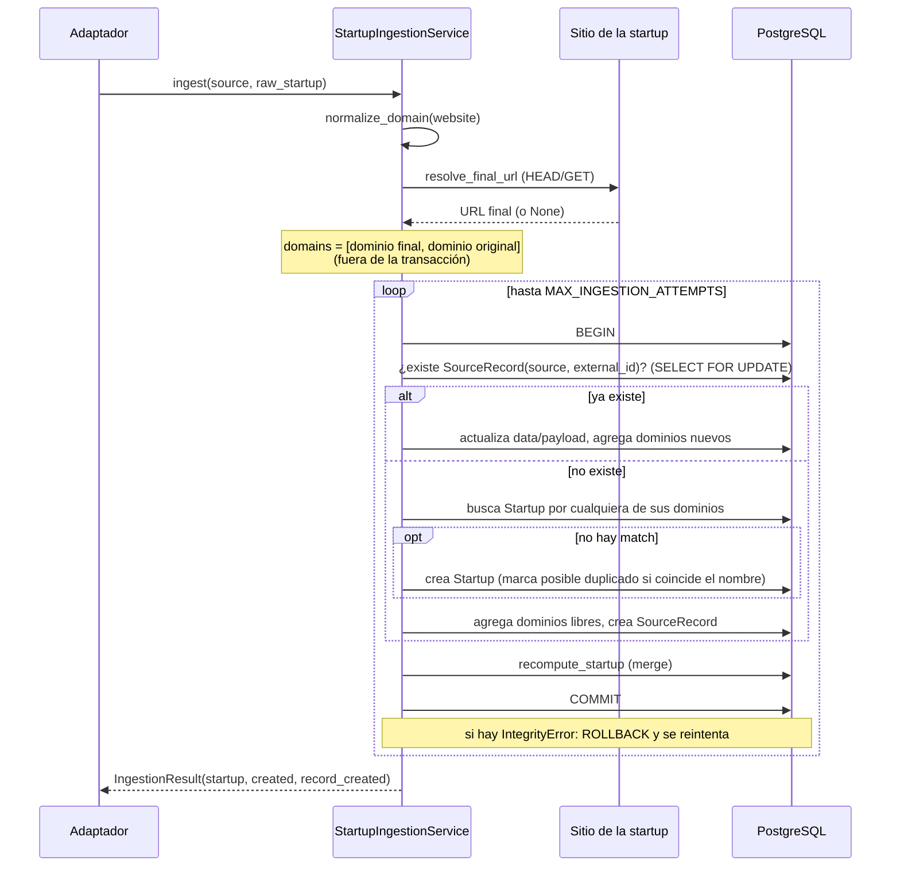
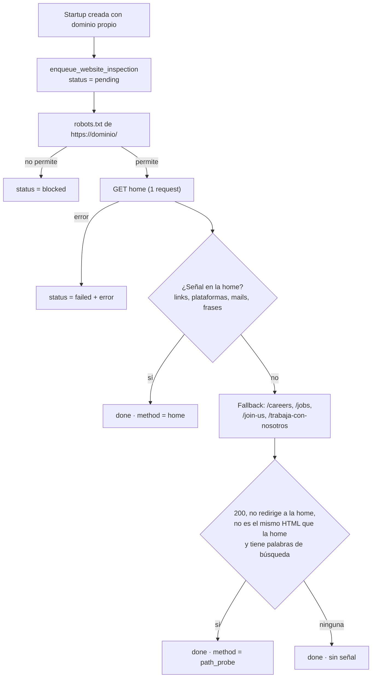
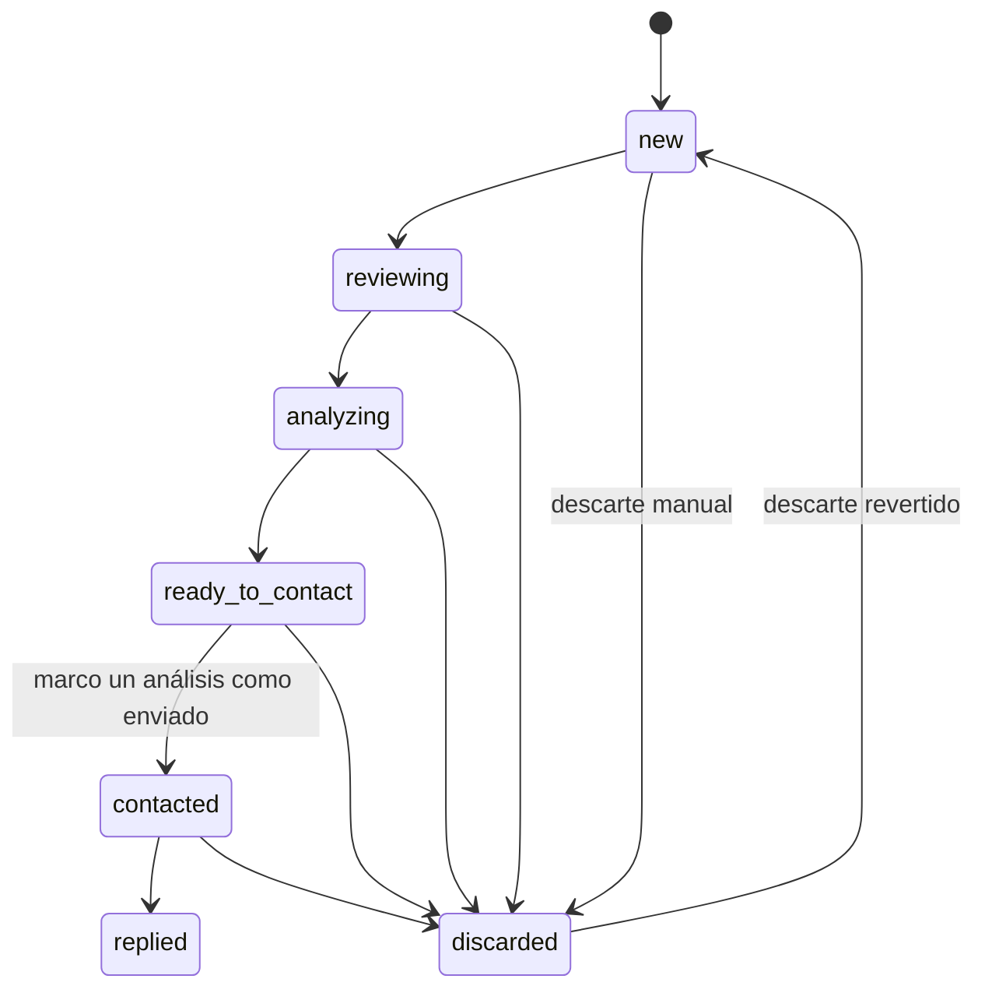

# Arquitectura de startup-scout

Este documento explica qué hace cada parte del código y cómo fluye una startup por el sistema, desde que una fuente la publica hasta que la contacto. Describe el estado al cierre de la **fase 3**. Lo que todavía no existe está marcado como _pendiente_, con la fase en la que llega según el [plan del MVP](startup-scout-design.md#10-plan-del-mvp).

## 1. Vista general

startup-scout tiene una sola responsabilidad: **mantener una lista de startups sin duplicados y con historial**, alimentada por varias fuentes, para que yo las revise y contacte a mano.

El código se organiza en tres apps de Django con responsabilidades separadas:

| App | Responsabilidad | Sabe de… | No sabe de… |
|---|---|---|---|
| `sources` | **De dónde vienen los datos.** Qué fuentes existen, cómo leer cada una y qué reportó cada una | Fuentes, adaptadores, corridas, registros crudos | Cómo se identifica o se fusiona una startup |
| `startups` | **Qué es una startup para nosotros.** Identidad, deduplicación, merge, contactos, análisis y estados | Startups, dominios, merge, ingesta | Cómo se lee cada fuente en particular |
| `web` | **La interfaz.** Pantallas con Django templates y HTMX | Formularios, vistas, templates | Reglas de negocio: llama a los servicios de `startups` y `sources` |

El contrato entre las dos es el dataclass `RawStartup`. Cada adaptador traduce su fuente a `RawStartup`, y la ingesta solo conoce ese formato. Agregar una fuente no toca nada de `startups`.

```
startup-scout/
├── config/                 Settings, URLs y WSGI de Django
├── sources/                App de fuentes
│   ├── adapters/
│   │   ├── base.py         Puerto SourceAdapter + RawStartup + SourceFetchResult
│   │   ├── algolia.py      Lectura paginada de la API de Algolia, compartida por los dos de HN
│   │   ├── html_text.py    Texto plano, links y dominio propio de los HTML de HN
│   │   ├── hacker_news.py  HackerNewsAdapter: Show HN y Launch HN
│   │   ├── hacker_news_hiring.py  HackerNewsHiringAdapter: "Ask HN: Who is hiring?"
│   │   └── manual.py       ManualSourceAdapter (alta manual por URL)
│   ├── registry.py         Mapeo en memoria: clave de fuente → adaptador
│   ├── runner.py           SourceRunner: corre una fuente y registra la corrida
│   ├── tasks.py            Tareas de huey: descubrimiento diario y una tarea por fuente
│   ├── management/commands/run_source.py   Correr una fuente a mano
│   ├── models.py           Source, SourceRecord, SourceRun
│   ├── constants.py        SourceKey, SourceRunStatus, parámetros de HN y del scheduler
│   ├── exceptions.py       UnknownSourceError, SourceFetchError
│   ├── migrations/         Esquema, alta de las fuentes y baja de Startupxplore
│   └── tests/              Incluye fixtures/ con respuestas ficticias de Algolia
├── startups/               App de startups
│   ├── domains.py          Normalización de dominios y de nombres
│   ├── redirects.py        Resolución de redirects (HttpRedirectResolver)
│   ├── merge.py            Merge de campos por prioridad de fuente
│   ├── ingestion.py        StartupIngestionService: dedupe + merge + concurrencia
│   ├── querysets.py        StartupQuerySet.with_hiring_signal(): señal por web o por aviso
│   ├── hiring_signal.py    Detección de búsquedas abiertas en un HTML (funciones puras)
│   ├── contact_extraction.py  Contactos en un HTML: mailto, LinkedIn, JSON-LD, cargos (funciones puras)
│   ├── contacts.py         save_contacts: guarda candidatos sin duplicar ni pisar lo revisado
│   ├── job_listing.py      Puestos de una página de careers y tableros (funciones puras)
│   ├── job_boards.py       APIs públicas de Ashby, Greenhouse y Lever
│   ├── openings.py         OpeningsVerifier: búsquedas activas de una startup
│   ├── web_pages.py        robots.txt y lectura de páginas, compartidos
│   ├── status.py           change_status / discard_startup: estados con historial
│   ├── analyses.py         Marcar y desmarcar un análisis como enviado
│   ├── duplicates.py       merge_startups / dismiss_duplicate
│   ├── page_metrics.py     Métricas de la home y regla de "probable SPA vacía"
│   ├── inspection_stats.py Cuántas inspecciones sin señal son probables SPA vacías
│   ├── website_inspection.py  WebsiteInspectionService: visita la web, robots.txt, fallback
│   ├── tasks.py            Tarea de huey que inspecciona la web de una startup
│   ├── domain_cleanup.py   Saca de las startups los dominios que hoy se consideran plataformas
│   ├── management/commands/inspect_websites.py        Inspeccionar las startups existentes
│   ├── management/commands/prune_platform_domains.py  Aplicar domain_cleanup a lo ya cargado
│   ├── models.py           Startup, StartupDomain, WebsiteInspection, Contact, Analysis, StatusChange
│   ├── constants.py        Estados, roles, prioridades, patrones y límites
│   ├── exceptions.py       InvalidWebsiteError, IngestionConflictError
│   ├── migrations/
│   └── tests/
├── web/                    App de la interfaz
│   ├── views/              startups, contacts, analyses, duplicates, runs
│   ├── forms.py            Filtros, estados, contactos, análisis, alta manual, fusión
│   ├── filters.py          Consulta y filtros del listado
│   ├── templatetags/       Markdown sanitizado y nombres de fuentes
│   ├── templates/web/      Páginas y fragmentos (partials) para HTMX
│   └── static/web/         CSS
└── docs/
```

## 2. App `sources`

### 2.1 `Source` (modelo)

Una fila por fuente configurada: hoy `hacker_news` y `manual`. Las crea la data migration `0002_seed_initial_sources`. Esa migración también creaba `startupxplore`, y la `0003_remove_startupxplore` la borra (ver §5.3).

| Campo | Para qué |
|---|---|
| `key` | Clave estable y única (`SourceKey`). Es lo único que conecta la fila con el código |
| `name` | Nombre visible en la web |
| `enabled` | Permite apagar una fuente sin borrarla |
| `config` | Parámetros del adaptador en JSON. Por ejemplo, HN usa `{"tags": ["show_hn", "launch_hn"]}` |

**Decisión: en la base nunca se guarda el nombre de una clase.** La `key` se resuelve a un adaptador con un mapeo en memoria (ver 2.5). Así se puede renombrar o mover un adaptador sin tocar los datos, y la base no queda atada a la estructura del código.

### 2.2 `SourceRecord` (modelo)

**Lo que una fuente dijo sobre una startup.** Si una startup aparece en HN y además la cargo a mano, tiene dos `SourceRecord`.

| Campo | Para qué |
|---|---|
| `source`, `external_id` | Identifican el registro dentro de su fuente: el id del post de HN o la URL normalizada en el alta manual. **Únicos juntos**, así una fuente no puede cargar dos veces lo mismo |
| `startup` | A qué startup unificada pertenece |
| `data` | Los campos ya traducidos a nuestro formato (`name`, `website`, `description`, `country`, `city`). **De acá se recalcula el merge** |
| `payload` | La respuesta cruda de la fuente, tal cual llegó. Sirve para depurar y para reprocesar si cambia el mapeo |
| `url` | Link a la startup en la fuente |
| `published_at` | Cuándo lo publicó la fuente (el post o el comentario de HN), si la fuente lo informa. Sirve para saber si un aviso de "Who is hiring?" es reciente |
| `first_seen_at`, `fetched_at` | Cuándo apareció por primera vez y cuándo se actualizó por última vez |

Guardar los registros por separado, en vez de pisar los datos de la startup, es lo que hace el merge **recalculable**: si cambia la prioridad de las fuentes, se recalcula y listo.

### 2.3 `SourceRun` (modelo)

Una fila por cada vez que corre una fuente: estado (`running`, `succeeded`, `failed`), cuántos ítems vio, cuántos eran nuevos, el error si lo hubo y un `cursor` en JSON para retomar desde donde quedó. Por ejemplo, el último `created_at_i` visto en HN. La corrida siguiente arranca del cursor de la **última corrida exitosa**; una corrida fallida no lo mueve. Sirve como historial y como observabilidad de cada fuente.

### 2.4 `RawStartup` y `SourceAdapter` (`adapters/base.py`)

- **`RawStartup`**: dataclass inmutable con lo que reporta una fuente, ya mapeado a nuestros nombres de campo. `country` llega como código ISO 3166-1 alfa-2 (`ES`), y la conversión es responsabilidad del adaptador. `published_at` es la fecha de publicación en la fuente, opcional. `contacts` son las personas que la fuente misma señala (el autor del post), como `ContactCandidate`. `mergeable_data()` devuelve los campos que entran al merge.
- **`SourceFetchResult`**: lo que devuelve una corrida de un adaptador: la lista de `RawStartup` y el `cursor` desde el que tiene que arrancar la próxima.
- **`SourceAdapter`**: el puerto (ports & adapters). Cada fuente implementa `fetch_candidates(cursor)`, que recibe `{}` en la primera corrida, y devuelve un `SourceFetchResult`. Recibe su `config` desde la fila `Source` y, opcionalmente, un `httpx.Client`; si no se le pasa, lo crea recién cuando lo necesita. En los tests se le inyecta uno con `MockTransport`. `runs_periodically` indica si el descubrimiento diario la corre. Un adaptador solo sabe leer su fuente: no deduplica ni guarda nada. Si no puede leerla, lanza `SourceFetchError`.

### 2.5 `registry.py`

`SOURCE_ADAPTERS` es un diccionario en memoria de `key` a clase de adaptador: hoy `hacker_news → HackerNewsAdapter`, `hacker_news_hiring → HackerNewsHiringAdapter` y `manual → ManualSourceAdapter`. `get_adapter(source)` busca la clave de la fila y devuelve el adaptador instanciado con su `config`. Si la clave no tiene adaptador, lanza `UnknownSourceError`. `runs_periodically(source)` dice si la fuente entra en el descubrimiento diario. Un test verifica que toda fuente habilitada tenga adaptador.

### 2.6 `HackerNewsAdapter` (`adapters/hacker_news.py`)

Lee posts de la API pública de Algolia (`search_by_date`), sin autenticación.

- **Qué trae**: los `tags` de su `config`, que hoy son `show_hn` y `launch_hn`. "Show HN" es un tag de Algolia. "Launch HN" (startups de YC) no lo es: se busca como texto en `story` y después se filtra por título, porque la búsqueda también trae posts que solo lo mencionan.
- **Cursor**: el `created_at_i` del post más nuevo visto, incluidos los descartados por título. Cada corrida vuelve a leer una hora antes del cursor (`HACKER_NEWS_CURSOR_OVERLAP_SECONDS`), porque Algolia a veces indexa tarde. Repetir posts no duplica nada: se vuelven a ingresar como actualización. Sin cursor, arranca `HACKER_NEWS_INITIAL_LOOKBACK_DAYS` días atrás (7, configurable con `initial_lookback_days`).
- **Paginación**: de a 100 posts por página, hasta `nbPages`.
- **Mapeo a `RawStartup`**:
  - `external_id` es el `objectID` del post, y `url` es el link al post en HN.
  - `name` es el título sin el prefijo, hasta el primer separador (` – `, ` — `, ` - `, `, ` o `: `) y sin el batch de YC (`(YC F26)`). Si el título no tiene separador, el nombre es el título completo, y eso pasa bastante en Show HN.
  - `description` es la frase después del separador. Si no hay, se usa el texto del post en texto plano, hasta 500 caracteres.
  - `website` es el link del post si es un dominio propio. Si es una plataforma (GitHub, App Store, YouTube…), se usa el primer dominio propio que aparezca linkeado en el texto. Si no hay ninguno, se deja el link a la plataforma, que no identifica a la startup (ver §3.6).
  - `raw_payload` es el hit completo, sin `_highlightResult`. Incluye `author`. El autor también va en `contacts`, como candidato con rol `founder` y link a su perfil de HN: quien publica un Show HN o un Launch HN suele ser el founder.

### 2.7 `HackerNewsHiringAdapter` (`adapters/hacker_news_hiring.py`)

Lee los avisos del hilo mensual "Ask HN: Who is hiring?", que publica el usuario `whoishiring`. Cada comentario de primer nivel es una empresa que está contratando. Las reglas y su porqué están en el [diseño §2](startup-scout-design.md#hn-who-is-hiring).

- **Hilos**: busca en Algolia los posts de `whoishiring` de los últimos 45 días (`HACKER_NEWS_HIRING_THREAD_MAX_AGE_DAYS`) cuyo título empieza con "Ask HN: Who is hiring?". Así quedan afuera "Who wants to be hired?" y "Freelancer?". La primera corrida lee solo el hilo más nuevo (`initial_threads` en el `config`).
- **Comentarios**: `tags=comment,story_<id>`, quedándose con los que tienen `parent_id` igual al hilo.
- **Cursor**: el `created_at_i` del comentario más nuevo, con la misma hora de solapamiento que §2.6. Mientras un hilo tenga menos de 45 días se sigue leyendo, así los avisos que llegan a mitad de mes no se pierden.
- **Mapeo a `RawStartup`**: `name` sale del primer segmento del encabezado sin paréntesis; `description` es el encabezado completo; `website` sigue el orden coincidencia con el nombre → link en el encabezado → dominio de un mail que no sea de un proveedor de correo (`FREE_EMAIL_DOMAINS`); `published_at` es la fecha del comentario y `raw_payload` el comentario entero, con su `author`. Si no hay encabezado o no hay web propia, el aviso se descarta y se cuenta en el log.

El autor del aviso va en `contacts` con rol `other`: los avisos los escriben tanto founders como recruiters.

`algolia.py` y `html_text.py` tienen lo que comparten los dos adaptadores de HN: la paginación de Algolia (que lanza `SourceFetchError` si la API falla), el texto plano, los links, `identifying_domain(url)` y `author_contact`, que arma el contacto del autor.

### 2.8 `ManualSourceAdapter` (`adapters/manual.py`)

No corre periódicamente: su `fetch_candidates` no trae nada. Expone `build_raw_startup(website, name="")`, que va a usar el formulario de alta manual de la web (fase 5):

- `external_id` es la URL normalizada (`acme.com/pricing`), así pegar dos veces el mismo sitio actualiza el mismo registro.
- Si no se da un nombre, usa el del dominio (`acme.com` → `Acme`).
- Si la URL no tiene dominio registrable, lanza `InvalidWebsiteError`.

### 2.9 `SourceRunner` (`runner.py`)

Corre una fuente de punta a punta:

1. Crea un `SourceRun` en `running`.
2. Toma el cursor de la última corrida exitosa.
3. Pide los candidatos al adaptador. Si falla (`SourceFetchError` o `UnknownSourceError`), cierra la corrida en `failed` con el error, y el cursor no se mueve.
4. Ingresa cada `RawStartup` con `StartupIngestionService`. Si una startup falla, el error queda anotado en `error` y la corrida sigue con las demás.
5. Por cada startup **creada**, llama a `on_startup_created`. Por defecto es `enqueue_website_inspection`, que encola la inspección de su web (§3.11). Es un parámetro para que los tests del runner no salgan a la red.
6. Guarda `items_seen`, `items_new` (startups **creadas**, no registros) y el cursor nuevo, y cierra en `succeeded`.

### 2.10 Tareas y comando (`tasks.py`, `run_source`)

- **`run_enabled_sources_task`**: tarea periódica de huey que corre **cada hora** (`DISCOVERY_CHECK_MINUTE`). Desde las 7:00 hora de Madrid (`DISCOVERY_HOUR`, calculada con el `TIME_ZONE` de Django), encola una `run_source_task` por cada fuente habilitada con `runs_periodically` que todavía no tuvo una corrida exitosa ese día desde esa hora. Así una fuente que falla no frena a las otras, una corrida fallida se reintenta a la hora siguiente y ninguna fuente corre más de una vez por día.

  **Por qué cada hora:** huey dispara una tarea periódica solo si el worker está despierto en ese minuto, y no recupera las perdidas. Con la Mac dormida a las 7:00, el 2026-11-20 no hubo descubrimiento (además, el crontab de huey se evalúa en UTC, así que en realidad estaba a las 8:00). Ahora la corrida del día se hace en el primer chequeo horario con la máquina despierta.
- **`run_source_task(source_id)`**: corre `SourceRunner` dentro de un lock de huey (`source-run-<key>`), para que dos corridas de la misma fuente no lean el mismo cursor a la vez. Si ya hay una corriendo, la nueva se saltea.
- **`python manage.py run_source <key>`**: corre una fuente en el momento, fuera del horario. Sirve para probar o para forzar una corrida.

## 3. App `startups`

### 3.1 `Startup` (modelo)

La startup **unificada**: una sola fila por startup real, venga de las fuentes que venga.

| Campo | Para qué |
|---|---|
| `name`, `website`, `description`, `country`, `city` | Valores **calculados por el merge** a partir de los `SourceRecord`. No se editan directo: una edición manual será un registro de la fuente `manual`, que tiene la prioridad más alta |
| `field_sources` | De qué fuente salió cada campo, por ejemplo `{"name": "manual", "description": "hacker_news"}` |
| `normalized_name` | Nombre comparable (sin tildes, puntuación ni "S.L."/"Inc."). Indexado, se usa para detectar posibles duplicados |
| `possible_duplicate_of` | Si se sospecha que es la misma que otra startup. **Nunca se fusionan solas**: lo confirmo yo desde la web (fase 5) |
| `status` | En qué punto del proceso está (ver §5.5) |
| `discard_reason` | Por qué la descarté (por ahora, solo descarte manual) |
| `remote_policy` | `unknown`, `remote`, `hybrid` u `onsite`. Se carga a mano; la regla de ubicación que lo usaría quedó como mejora futura |
| `hq_country`, `hq_city`, `hq_timezone` | Dónde está establecida (§3.16): país ISO, ciudad y zona IANA. Vacíos si no se sabe. **No** salen del merge: los calcula `headquarters.py` |
| `location_source`, `location_evidence`, `location_detected_at` | De dónde salió la ubicación (`manual`, `website_address`, `headquarters`, `workplaces`, `country_domain`, `remote`), el texto o dominio que la respalda y cuándo se detectó |
| `first_seen_at` | Cuándo la descubrimos. El listado ordena por este campo, de la más nueva a la más vieja |

### 3.2 `StartupDomain` (modelo)

**La identidad de la startup.** Cada startup tiene uno o más dominios normalizados y uno de ellos es el principal (`is_primary`). Los demás son alias, por ejemplo el dominio desde el que redirige su web. `domain` es **único en toda la tabla**: es el constraint que garantiza que no haya dos startups con el mismo dominio, incluso con ingestas concurrentes.

### 3.3 `Contact` (modelo)

Personas o canales para contactar a la startup: CEO, CTO, founder, otro cargo o un contacto general como `hello@`. Registra cómo se encontró (`found_via`: la fuente, la web de la startup o carga manual), la URL donde aparece (`evidence_url`) y su estado (`candidate`, `confirmed` o `rejected`). Los candidatos se confirman a mano. Los cargan la inspección de la web (§3.13) y las fuentes (el autor del post de HN), siempre con `contacts.save_contacts`, que no duplica ni deshace lo que ya revisé.

### 3.4 `Analysis` (modelo)

Mis análisis de una startup, en markdown. Puede haber varios por startup. "Enviado" significa `sent_at` no nulo (propiedad `is_sent`); `sent_to` apunta al contacto al que se lo mandé. _El modelo existe; el CRUD en la web llega en la fase 5._

### 3.5 `StatusChange` (modelo)

El historial de cambios de estado de cada startup: estado anterior, estado nuevo, una nota y la fecha. Lo escriben los cambios manuales y el paso automático a `contacted` al marcar un análisis como enviado. _Se empieza a escribir en la fase 5._

### 3.6 `domains.py`

- **`normalize_domain(website)`**: de cualquier URL o host obtiene su **dominio registrable**. Ejemplos: `https://www.Acme.com/pricing` → `acme.com`, `app.acme.com` → `acme.com`, `www.müller.de` → `xn--mller-kva.de`.
  - Usa la Public Suffix List **con los sufijos privados**, así `foo.vercel.app` y `bar.vercel.app` siguen siendo distintos.
  - La lista viene incluida en `tldextract`: no hay acceso a red ni caché en disco, y el resultado es determinístico.
  - **Hosts compartidos** que no están en la Public Suffix List (`substack.com`, `medium.com`, `itch.io`, `gitbook.io`, `wordpress.com`, etc.: `SHARED_HOST_DOMAINS`): se conserva el subdominio, así `acme.substack.com` identifica a Acme.
  - Si el valor no tiene un dominio registrable (vacío, IP, `localhost` o texto que no es una URL), lanza `InvalidWebsiteError`.
- **`is_identifying_domain(domain)`**: dice si un dominio identifica a **una** startup. Es falso para las plataformas donde el link apunta a contenido adentro (`github.com`, `apple.com`, `google.com`, `youtube.com`, `x.com`, `producthunt.com`, y marketplaces como `plugins.jetbrains.com`, `marketplace.visualstudio.com` o `vercel.com/templates`…, en `NON_IDENTIFYING_DOMAINS`) y para un host compartido sin subdominio. Sin esto, todos los Show HN que linkean a GitHub terminarían fusionados en una sola startup llamada `github.com`.
- **`normalize_url(website)`**: forma comparable de una URL completa: host sin `www.`, más el path (`acme.com/pricing`). La usa el alta manual como `external_id`.
- **`normalize_name(name)`**: forma comparable de un nombre. `"Ácme, S.L.U."` → `"acme"`. Saca tildes, puntuación, mayúsculas y sufijos legales del final (la lista está en `LEGAL_NAME_SUFFIXES`), pero deja siempre al menos una palabra.

### 3.7 `redirects.py`

`HttpRedirectResolver.resolve_final_url(url)` sigue los redirects de un sitio y devuelve la URL final, o `None` si el sitio no responde. Primero prueba con `HEAD`; si el servidor lo rechaza (403, 405, 501), reintenta con `GET` en streaming, sin descargar el cuerpo. Es una dependencia inyectable: en los tests se reemplaza por `FakeRedirectResolver`, sin red.

### 3.8 `merge.py`

- **`merge_source_data(records)`**: función pura. Recibe pares `(source_key, data)` y, **campo por campo**, se queda con el primer valor no vacío según `SOURCE_MERGE_PRIORITY` (`manual > hacker_news`). Las fuentes que no están en la lista van al final. Devuelve los valores y la procedencia de cada uno.
- **`recompute_startup(startup)`**: lee todos los `SourceRecord` de la startup, aplica el merge y guarda los campos, `normalized_name` y `field_sources`. Es idempotente: correrlo dos veces da lo mismo.

### 3.9 `ingestion.py`: `StartupIngestionService`

El corazón de la fase 1. `ingest(source, raw_startup)` convierte lo que reporta una fuente en una startup única, y devuelve un `IngestionResult(startup, created, record_created)`. El paso a paso está en §5.2.

### 3.10 `WebsiteInspection` (modelo)

El resultado de visitar la web propia de una startup. Hay uno por startup (`OneToOneField`, `startup.website_inspection`), y hoy responde una sola pregunta: **¿muestra búsquedas abiertas?**

| Campo | Para qué |
|---|---|
| `status` | `pending` (encolada), `done`, `blocked` (robots.txt no lo permite) o `failed` (no responde o devuelve error) |
| `inspected_at` | Cuándo se inspeccionó por última vez |
| `has_hiring_signal` | Si se encontró la señal. Indexado: el listado ordena por este campo |
| `hiring_signal_method` | `home` (estaba en la home) o `path_probe` (salió del fallback por rutas típicas) |
| `hiring_signal_kind` | Qué tipo de señal fue, de más fuerte a más débil: `job_board`, `link_path`, `link_text`, `email` o `phrase` |
| `hiring_signal_url`, `hiring_signal_text` | La evidencia: a dónde apuntaba y qué decía. Sirve para revisar falsos positivos |
| `home_text_length`, `home_link_count`, `home_has_app_root` | Lo que muestra la home sin JavaScript: largo del texto visible, cantidad de links y si tiene un contenedor de framework. Nulos si la home no se pudo leer. Sirven para medir las SPA vacías (§3.12) |
| `error` | El error, si la inspección falló |

`contacts_found` cuenta los contactos encontrados en la última visita; los contactos mismos se guardan en `Contact` (§3.13).

### 3.11 Búsquedas abiertas: `hiring_signal.py`, `website_inspection.py` y `tasks.py`

- **`hiring_signal.py`**: funciones **puras**, sin red ni base. `detect_hiring_signal(html, page_url)` devuelve la señal **más fuerte** de la página, o `None`. Recorre todos los links (nav, cuerpo y footer: es el mismo HTML) y el texto visible, sin scripts ni estilos:
  - `job_board`: links a plataformas de búsqueda (`JOB_BOARD_DOMAINS`: Greenhouse, Lever, Ashby, Workable…) o a la sección `/jobs` de LinkedIn, Wellfound o YC.
  - `link_path`: links **del mismo sitio** cuyo path tiene un segmento de búsqueda (`/careers`, `/jobs`, `/join-us`, `/empleo`…, en `HIRING_PATH_PATTERN`).
  - `link_text`: texto de link como "Careers" o "Jobs" (palabra sola y completa) o una frase como "Work with us" o "Trabaja con nosotros".
  - `email`: un `mailto:` a `jobs@`, `careers@`, `talent@`, etc.
  - `phrase`: frases en el texto visible como "We're hiring" o "Estamos contratando".

  Los links de `link_path` no cuentan si están bajo una sección de documentación o similar (`/docs`, `/api`, `/blog`, `/help`…, en `HIRING_PATH_EXCLUDED_SECTIONS`): `/docs/applications/jobs` habla de tareas programadas, no de búsquedas. "Join us" a secas no cuenta, salvo que el link vaya a una ruta de búsqueda. Los textos se comparan normalizados (`normalize_text`: minúsculas, sin tildes, la puntuación como espacios) y por palabra completa, así "Steve Jobs" no dispara nada.
- **`WebsiteInspectionService.inspect(startup)`**: hace la visita (§5.4) y guarda el `WebsiteInspection`. Si la startup no tiene dominio propio (por ejemplo, solo un link a GitHub), devuelve `None` y no guarda nada.
- **`enqueue_website_inspection(startup)`**: marca la inspección como `pending` y encola `inspect_website_task` en huey. La usa el runner al crear una startup.
- **`python manage.py prune_platform_domains`** (`domain_cleanup.py`): cuando se agrega una plataforma a `NON_IDENTIFYING_DOMAINS` o a `SHARED_HOST_DOMAINS`, las startups cargadas antes siguen teniendo ese dominio. Este comando borra esos dominios y su inspección (que en realidad inspeccionó la plataforma), y le reasigna a cada startup su dominio propio a partir de sus registros, si lo tiene. Ejemplo: `bolt.host` pasa a `acme-app.bolt.host`.
- **`python manage.py inspect_websites`**: inspecciona, de a una, las startups con dominio propio que nunca se inspeccionaron (o que quedaron `pending` o `failed`). Con `--all` las inspecciona todas de nuevo; `--limit N` acota la cantidad. Al terminar imprime un resumen. Con `--stats` no inspecciona nada: lista las probables SPA vacías (§3.12).
- **`prune_platform_domains`** también promueve a principal el dominio que quedó como alias cuando el principal era una plataforma. Pasa cuando el link de la fuente redirige a una plataforma, como `go.gene.com` → Workday.

### 3.12 Anotaciones y medición de SPA: `querysets.py`, `page_metrics.py`, `inspection_stats.py`

- **`Startup.objects.with_openings()`**: `openings_state` (el `OpeningsStatus` de la última verificación, `not_checked` si no hubo), `openings_count`, `latest_opening_at` (la fecha de la búsqueda más nueva con fecha) y `has_remote_opening`. **`with_contact_kinds()`**: `has_person_contact` (CEO, CTO o founder no rechazado), `has_general_contact` y `has_key_contact`. **`with_analysis_state()`**: `has_analysis` y `has_sent_analysis`. Todo se calcula en cada consulta con subconsultas: no hay flags guardados que se desactualicen.
- **Admin**: el listado de startups ordena por cantidad de búsquedas activas y filtra por estado de búsquedas. El orden se define en `get_ordering`, porque los checks del admin no aceptan una anotación en `ordering`. `JobOpening` tiene su propia lista y aparece dentro de cada startup.
- **`page_metrics.py`**: `measure_page(html)` mide la home y `is_probable_spa_shell(metrics)` aplica la regla: menos de `SPA_SHELL_MAX_TEXT_LENGTH` (200) caracteres visibles, o un contenedor de framework (`APP_ROOT_ELEMENT_IDS`) con menos de `SPA_SHELL_MIN_LINK_COUNT` (3) links. Son umbrales para revisar a mano, no una certeza.
- **`inspection_stats.spa_shell_stats()`**: entre las inspecciones `done` sin señal, cuenta las que todavía no tienen métricas (inspeccionadas antes de que existieran) y devuelve las probables SPA vacías.

### 3.15 Búsquedas activas: `job_listing.py`, `job_boards.py` y `openings.py`

- **`job_listing.py`** (funciones puras): `find_job_board(texto)` encuentra el primer tablero de Ashby, Greenhouse o Lever en un HTML o una URL (`jobs.ashbyhq.com/{org}`, `job-boards.greenhouse.io/{token}` o su embed `?for={token}`, `jobs.lever.co/{site}`). `extract_openings(html, url)` lee los puestos de una página de careers: links a páginas de puestos del mismo sitio (debajo de la página, o `/jobs/<slug>`, `/careers/<slug>`…) o de un tablero, cuyo texto nombra un puesto (Engineer, Designer, Manager…), y los `JobPosting` de schema.org con su `datePosted`. En YC o Wellfound solo cuentan los links debajo de la página de la empresa: el resto es el directorio de la plataforma. Descarta las postulaciones genéricas. `says_no_openings` reconoce "No open positions" y similares; `open_positions_links` encuentra los "See open positions".
- **`job_boards.py`**: `JobBoardClient.fetch_openings(board)` lee las APIs públicas oficiales (Ashby `publishedAt`, Greenhouse `first_published`, Lever `createdAt`, con reintento en el host EU de Lever). Si el tablero no existe o la API falla, lanza `JobBoardError` y la verificación sigue con la página.
- **`openings.py`**: `OpeningsVerifier.verify(startup)` elige dónde mirar (la URL de la señal si es una página de careers de la startup, después los tableros linkeados desde sus avisos de Who is hiring), aplica el orden tablero → página → link "open positions", filtra las búsquedas con fecha de más de `OPENINGS_MAX_AGE_DAYS` (60), **reemplaza** los `JobOpening` y guarda `openings_status`, `openings_url` y `openings_checked_at`. Una señal sin página propia que leer (un `jobs@`, un mail ofuscado de Cloudflare, otro sitio) queda `unverified`; sin señal ni avisos, `not_checked`. Respeta robots.txt y reutiliza el de la inspección.
- **Cuándo corre**: al final de cada inspección de la web (también si la web bloqueó o falló, porque un tablero de un aviso no necesita la web); `recheck_openings_task` cada hora re-verifica de a `OPENINGS_RECHECK_BATCH` (50) las que tienen más de `OPENINGS_RECHECK_DAYS` (7) días; y `python manage.py verify_openings` (con `--all` y `--limit`) para las ya cargadas.

### 3.16 Ubicación: `locations.py`, `organization_address.py` y `headquarters.py`

- **`locations.py`** (funciones puras, datos de GeoNames vía `geonamescache`, índices armados una vez por proceso): `resolve_places(texto, country_hint, preferred_country)` devuelve los `Place(country, timezone_name, city)` que nombra un texto; `closest_place`, `hours_from_reference` e `is_near_reference` miden contra `Europe/Madrid` en un momento dado; `timezones_near_reference(zonas, ahora)` filtra las de menos de `MAX_HOURS_FROM_REFERENCE` (5); `country_from_domain`, `names_headquarters` y `hiring_post_places` (encabezado de un aviso de Who is hiring, sin el nombre de la empresa ni los segmentos que nombran puestos).
- **`organization_address.py`**: `organization_location(html)` lee el `address` de la `Organization` de schema.org de la home. La inspección lo guarda en `WebsiteInspection.organization_location`.
- **`job_boards.py`** suma `country_hint` a cada puesto (Ashby `address.postalAddress.addressCountry`, Lever `country`) y `fetch_headquarters(board)`: la oficina "Headquarters" de `/v1/boards/{token}/offices` de Greenhouse. El verificador la guarda en `WebsiteInspection.headquarters_location`.
- **`openings.py`**: al guardar los puestos, cada uno se ubica en el lugar más cercano a Madrid de los que nombra; al final de `verify`, llama a `detect_location`.
- **`headquarters.py`**: `detect_location(startup)` elige por prioridad (manual, dirección de la web, sede declarada, lugares de trabajo, dominio de país, remoto o regiones sin país), con el candidato más cercano a Madrid en los empates, y guarda los campos de ubicación de `Startup`; `correct_location(startup, país, ciudad)` y `reset_location(startup)` son la corrección a mano y la vuelta a la detección. `python manage.py detect_locations` (con `--all`) la corre sobre lo ya guardado, sin requests.

### 3.13 Contactos: `contact_extraction.py` y `contacts.py`

- **`contact_extraction.py`**: funciones **puras**. `extract_contacts(html, page_url)` devuelve los `ContactCandidate` de la página, ya unificados (misma persona = mismo mail, mismo perfil o mismo nombre; gana el rol más fuerte: CEO, CTO, founder, otro, general):
  - **Mails** en links `mailto:` o en el texto visible, **solo del dominio de la startup**. Los buzones genéricos (`hello@`, `info@`, `contact@`…, `GENERAL_EMAIL_LOCAL_PARTS`) son contacto general; los de búsquedas (`jobs@`, `careers@`) se ignoran; el resto es una persona con rol "otro", con nombre si el texto del link lo es.
  - **Perfiles de LinkedIn** (`linkedin.com/in/…`): solo la URL, LinkedIn nunca se visita. Las páginas de empresa (`/company/`) no son contactos.
  - **JSON-LD** de schema.org: cada `Person` con un `jobTitle` de CEO, CTO o founder, o que esté bajo `founder`. Toma también su mail y su LinkedIn de `sameAs`.
  - **Nombres junto a cargos**: una línea corta con un cargo ("CEO & Co-founder", "Cofundadora") toma como nombre el fragmento de texto anterior que parezca un nombre (2 a 4 palabras con mayúscula, sin palabras de cargos, lugares o etiquetas como "General Counsel" o "San Francisco"), como en las tarjetas de equipo. También "Jane Roe, Founder" en una sola línea. Si la tarjeta tiene un único link a LinkedIn, se suma como perfil. Los cargos se reconocen por palabra completa: "Our Founders" o "for CTOs" no son personas.
  - **Testimonios, clientes e inversores no son el equipo.** La primera corrida real puso al CEO de Datadog como CEO de Railway: era una cita de un cliente. Por eso se descarta a una persona si su cargo nombra a otra empresa ("CEO at Globex", "CTO, Globex", o "Co-founder" "at" "Globex" en fragmentos separados) que no coincide con el dominio de la startup; si está bajo un título de sección como "Backed by", "Investors", "Advisors" o "What our customers say" (`NON_TEAM_SECTION_PHRASES`); o, en JSON-LD, si no está bajo `founder`, `employee` o `member` (los autores de reseñas quedan afuera) o su `worksFor` es otra empresa.

  `contact_page_links(html, page_url)` da los links de la home a páginas del mismo sitio cuyo último segmento es `about`, `team`, `contact`, `nosotros`, `equipo`… (`CONTACT_PAGE_SLUGS`).
- **En la inspección** (`WebsiteInspectionService._collect_contacts`): después de la señal de búsquedas, extrae de la home y de las páginas de contacto que linkea. Si no linkea ninguna, prueba `CONTACT_FALLBACK_PATHS` (`/about`, `/about-us`, `/team`, `/contact`, `/nosotros`, `/equipo`, `/quienes-somos`, `/contacto`). Como máximo 8 páginas además de la home, respetando robots.txt, y descartando las que redirigen a la home o devuelven el mismo HTML (SPA).
- **`contacts.save_contacts(startup, candidates, found_via)`**: crea los candidatos nuevos con estado `candidate`. Si el contacto ya existe en esa startup (mismo mail, perfil o nombre, sin importar cómo se encontró), solo completa sus campos vacíos: no cambia nombre, rol ni estado, así una nueva inspección no deshace lo que confirmé o rechacé.
- **Migración `startups/0005`**: crea los contactos de los autores de HN de los registros ya cargados, a partir del `author` del payload.

### 3.14 Servicios que usa la web: `status.py`, `analyses.py`, `duplicates.py` y `sources/manual_entry.py`

- **`change_status(startup, to_status, note)`**: cambia el estado y deja un `StatusChange`. Descartar exige motivo (`DiscardReasonRequiredError`) y lo guarda en `discard_reason`; salir de `discarded` lo limpia. `discard_startup` es el atajo del listado.
- **`mark_analysis_sent(analysis, sent_at, sent_to)`**: guarda fecha y contacto (que tiene que ser de la misma startup: `ForeignContactError`) y pasa la startup a `contacted`, salvo que ya esté en `contacted` o `replied`. `unmark_analysis_sent` deshace la marca sin tocar el historial.
- **`merge_startups(kept, duplicate)`**: mueve dominios (como alias), registros, análisis e historial; los contactos se unifican con `find_matching_contact` (el de la conservada gana y completa campos vacíos); la inspección de la conservada gana. Los posibles duplicados que apuntaban a la borrada pasan a apuntar a la conservada. Al final recalcula el merge. `dismiss_duplicate` borra la marca.
- **`add_startup_manually(website, name)`** (`sources/manual_entry.py`): arma el `RawStartup` con `ManualSourceAdapter`, lo ingresa como fuente `manual` (mismo dedupe que el resto) y, si la startup es nueva, encola la inspección de su web.

## 4. Configuración relevante

| Setting / constante | Dónde | Para qué |
|---|---|---|
| `HUEY` | `config/settings.py` | Cola de tareas en Redis. `HUEY_IMMEDIATE=true` corre las tareas en línea, como en la CI |
| `SOURCE_MERGE_PRIORITY` | `startups/constants.py` | Orden de confianza entre fuentes para el merge |
| `MAX_INGESTION_ATTEMPTS` | `startups/constants.py` | Reintentos ante choques de concurrencia (3) |
| `REDIRECT_TIMEOUT_SECONDS` | `startups/constants.py` | Timeout al resolver redirects (10 s) |
| `HIRING_*`, `JOB_BOARD_DOMAINS`, `JOB_SECTION_DOMAINS` | `startups/constants.py` | Qué cuenta como señal de búsqueda: paths, textos, frases, mails y plataformas |
| `HIRING_FALLBACK_PATHS` | `startups/constants.py` | Rutas del fallback, en orden: `/careers`, `/jobs`, `/join-us`, `/trabaja-con-nosotros` |
| `INSPECTION_TIMEOUT_SECONDS`, `INSPECTION_USER_AGENT` | `startups/constants.py` | Timeout (10 s) y User-Agent identificable (`startup-scout/0.1`) de la inspección |
| `OPENINGS_MAX_AGE_DAYS`, `OPENINGS_RECHECK_*` | `startups/constants.py` | Antigüedad máxima de una búsqueda con fecha (60 días) y re-verificación semanal (de a 50 por hora) |
| `JOB_BOARD_PATTERNS`, `*_API_URL`, `GENERIC_APPLICATION_PHRASES`, `NO_OPENINGS_PHRASES`, `JOB_TITLE_WORDS` | `startups/constants.py` | Tableros reconocidos, sus APIs y las reglas para leer una página de careers |
| `SPA_SHELL_*`, `APP_ROOT_ELEMENT_IDS` | `startups/constants.py` | Regla de "probable SPA vacía" |
| `CONTACT_*`, `GENERAL_EMAIL_LOCAL_PARTS`, `ROLE_TITLE_PHRASES`, `PERSON_NAME_*` | `startups/constants.py` | Páginas de contacto, buzones genéricos, cargos y qué parece un nombre |
| `HACKER_NEWS_HIRING_*`, `FREE_EMAIL_DOMAINS` | `sources/constants.py` | Hilos de "Who is hiring?", ventana de relectura y proveedores de correo que no sirven como web |

## 5. Proceso / pipeline

### 5.1 Vista de punta a punta



| Paso | Estado |
|---|---|
| Tarea periódica, runner, `SourceRun` y adaptadores de HN y alta manual | **Implementado (fase 2)** |
| `get_adapter` / registro | **Implementado** |
| Ingesta: dedupe, merge y concurrencia | **Implementado (fase 1)** |
| Señal de búsquedas abiertas | **Implementado (fase 3)** |
| Extracción de contactos | **Implementado (fase 4)** |
| Web: listado, ficha, análisis, estados | **Implementado (fase 5)**, ver §6 |

### 5.2 Ingesta de una startup (implementado)



Paso a paso:

1. **Dominios (fuera de la transacción).** Se normaliza el `website`. Si no tiene dominio registrable, o si el dominio es de una plataforma (`is_identifying_domain`), la startup se ingresa sin dominio; el `website` igual queda guardado. Un redirect hacia una plataforma tampoco se usa como alias. Después se resuelven los redirects: si la web redirige a otro dominio (`acme.io` → `acme.com`), los dos identifican a la startup y el destino queda como principal. La llamada de red va antes de abrir la transacción para que esta sea corta.
2. **¿Ya conocemos este registro?** Se busca `SourceRecord(source, external_id)` con `SELECT FOR UPDATE`. Si existe, es una re-ingesta: se actualizan `data` y `payload`, se agregan los dominios nuevos y se recalcula el merge. No se crea nada.
3. **¿Ya conocemos la startup?** Se busca una startup que tenga **cualquiera** de los dominios.
   - Si hay una, se usa esa.
   - Si los dominios apuntan a dos startups distintas (por ejemplo, se cargaron `acme.io` y `acme.com` por separado y ahora sabemos que una redirige a la otra), se usa la más antigua y la otra queda marcada `possible_duplicate_of`. **No se fusionan solas.**
4. **Startup nueva.** Si no hubo match, se crea. Si su nombre normalizado coincide con el de otra startup existente, queda marcada como posible duplicado. Esto cubre sobre todo las startups sin web: el nombre solo marca, nunca fusiona, porque dos empresas pueden llamarse igual.
5. **Dominios y registro.** Se agregan los dominios que no tenga otra startup (el primero es el principal) y se crea el `SourceRecord`.
6. **Merge.** `recompute_startup` recalcula todos los campos a partir de todos los registros.
7. **Concurrencia.** Si dos ingestas de la misma startup corren a la vez (dos fuentes o dos workers), ambas pueden no encontrar nada y tratar de crearla. Los constraints únicos (`StartupDomain.domain` y `(source, external_id)`) hacen que una falle con `IntegrityError`. Su transacción se deshace entera, se reintenta, y en el reintento ya encuentra la startup de la otra y se suma como un registro más. Después de `MAX_INGESTION_ATTEMPTS` intentos fallidos lanza `IngestionConflictError`.

### 5.3 Descubrimiento por fuente (implementado, fase 2)

- **Hacker News**: ver §2.6. Una corrida real del último día trajo 205 posts y dio 204 startups (dos posts eran de la misma empresa). Unas 60 quedaron sin dominio porque solo linkean a GitHub. Show HN trae mucho ruido, como esperábamos.
- **HN Who is hiring**: ver §2.7. La primera corrida real (2026-11-19) leyó el hilo de noviembre: **155 avisos con web propia, 154 startups nuevas** (una ya existía por Show HN) en ~1,5 minutos, incluida la resolución de redirects. Revisando la lista a mano, casi todas las webs son correctas. Errores encontrados:
  - `go.gene.com` redirigía a Workday (`myworkdayjobs.com`), que quedó como dominio principal. Se sumaron Workday, iCIMS y Jobvite a las plataformas de búsqueda, y `prune_platform_domains` ahora promueve el alias propio.
  - Algunos nombres salen raros cuando el encabezado no empieza con la empresa (por ejemplo, "SEEKING FREELANCER"). Es poco frecuente y se corrige al revisar.
  - Los avisos con la web en Notion (`acme.notion.site`) quedan con ese subdominio como identidad.
- **Alta manual**: el adaptador ya arma el `RawStartup` (§2.8). El formulario llega en la fase 5 y usa la misma ingesta.
- **Startupxplore: descartada y eliminada.** Sus términos de uso prohíben reproducir su base de datos sin consentimiento escrito. La migración `0003_remove_startupxplore` borra la fuente (y sus registros, si los hubiera) y la saca de los choices de `SourceKey`. El detalle está en [Fuentes descartadas](startup-scout-design.md#fuentes-descartadas), junto con EU-Startups.

### 5.4 Inspección de la web: búsquedas abiertas (implementado, fase 3)



1. **robots.txt**: se lee el del dominio. Si no existe (404), se permite todo. Si responde 401/403 o un error 5xx, no se permite nada y la inspección queda `blocked`. Si no permite la home, también queda `blocked` y no se pide ninguna página.
2. **Home**: `GET https://<dominio>/`, siguiendo redirects. Si la raíz da 404 y el `website` de la startup es una página del mismo dominio bajo un path (típico de GitHub Pages: `usuario.github.io/proyecto`), se usa esa página como home. Si falla la conexión o responde con error, queda `failed`. Si hay señal, termina acá con **un solo request de página**.
3. **Fallback**: solo si la home no dio señal. Prueba las rutas en orden (salteando las que prohíbe robots.txt) y corta en la primera que cumpla todo esto:
   - responde 200,
   - no termina en la home ni en otro sitio,
   - su texto visible es distinto del de la home (las SPA devuelven el mismo HTML para cualquier ruta),
   - y contiene palabras de búsqueda (`HIRING_PAGE_KEYWORDS`).

   Si un request del fallback falla, se sigue con la ruta siguiente.
4. **Guardado**: estado, fecha, señal y evidencia. Si se inspecciona de nuevo, se actualiza el mismo registro.

**Límites conocidos**: no ejecuta JavaScript, así que en las SPA puras solo el fallback puede encontrar algo (para medirlo: `inspect_websites --stats`, §3.12). Solo prueba `https`. Y es una señal, no una certeza: una página de "Careers" puede no tener búsquedas activas.

**Corrida real (2026-11-19), sobre las startups de HN ya cargadas:**

| Corrida | Inspeccionadas | Con señal | `done` | `blocked` | `failed` |
|---|---|---|---|---|---|
| Primera | 262 | 19 | 232 | 7 | 23 |
| Después de las correcciones | 259 | 14 | 244 | 6 | 9 |

La segunda corrida tardó ~4,5 minutos. Revisar la evidencia de la primera mostró tres problemas, ya corregidos:

- **Dominios de plataformas como identidad**: posts que linkeaban a `plugins.jetbrains.com`, `marketplace.visualstudio.com`, `vercel.com/templates` o `*.bolt.host`, así que se inspeccionaba la home de JetBrains, Microsoft o Vercel (5 falsos positivos). Se sumaron a `NON_IDENTIFYING_DOMAINS` y `SHARED_HOST_DOMAINS`, y `prune_platform_domains` limpió los 4 dominios ya cargados.
- **Rutas de documentación**: `/docs/applications/jobs/` daba señal. Ahora se excluyen las secciones de docs, API, blog y ayuda.
- **GitHub Pages**: la raíz de `usuario.github.io` daba 404 cuando el proyecto vive en `/proyecto`. Los `failed` bajaron de 23 a 9; los que quedan son dominios que no resuelven en DNS y timeouts.

De las 14 señales finales, 11 son búsquedas reales: links a `/careers`, a la página de empleos de YC o a Ashby. Las otras 3 son startups **cuyo producto es una bolsa de trabajo** (su `/jobs` es el producto): es un límite conocido, que se distingue rápido al revisar.

**Sobre las startups de "Who is hiring?"**, que sabemos que están contratando, la inspección de la web encontró la señal en **106 de 151** inspeccionadas (~70 %). Es una medida de cuánto detecta la inspección cuando la búsqueda existe. Con las dos fuentes, el admin muestra **168 startups con señal** de 527, contra 14 antes.

**Búsquedas activas (2026-11-23)**: `verify_openings --all` sobre las 184 startups con señal en la web o aviso en Who is hiring tardó ~1 minuto. Resultado: **63 con búsquedas activas** (538 puestos: 223 de Ashby, 108 de Greenhouse, 5 de Lever y el resto de páginas propias; 226 remotos), 7 sin búsquedas activas, 65 sin verificar y 49 sin nada que verificar (avisos de Who is hiring sin señal en la web ni tablero linkeado). Revisando una muestra de los puestos leídos de páginas propias, casi todos son reales. Se corrigieron dos fuentes de falsos positivos (el directorio de Wellfound y la bolsa de trabajo de itch.io, a las que apuntaban dos señales) y se sumaron el redirect con tablero, el link "See open positions" y los mails ofuscados de Cloudflare. Sigue habiendo un límite conocido: una startup cuyo producto es una bolsa de trabajo lista puestos de otras empresas.

**Contactos (fase 4, 2026-11-19)**: `inspect_websites --all` sobre 413 startups con dominio propio tardó ~17 minutos (antes ~1 s por sitio, ahora ~2,5 s, por las páginas de contacto; las visitas son en serie). Resultado, después de corregir los testimonios:

| | Cantidad |
|---|---|
| Startups con algún contacto de su web | 197 |
| Startups con una persona CEO, CTO o founder | 88 |
| Startups con un mail general (`hello@`, `info@`…) | 101 |
| Contactos de la web: CEO / CTO / founder / otro / general | 59 / 31 / 59 / 714 / 113 |
| Contactos de autores de HN (todas las startups de HN) | 528 |

Los "otro" son sobre todo perfiles de LinkedIn de páginas de equipo completas. Revisando la lista de personas a mano, la gran mayoría son el equipo real. Quedan errores sueltos, como una frase tomada por nombre ("Executive Resilience") o algún testimonio que no nombra a su empresa. Por eso todo entra como candidato a confirmar.

Medición de SPA (`inspect_websites --stats`, después de reinspeccionar todo): de 273 inspecciones `done` sin señal, **43 son probables SPA vacías**. Esa es la lista a revisar a mano en el navegador para decidir si vale la pena un navegador headless.


### 5.5 Estados de una startup



Todos los cambios son manuales, salvo el paso a `contacted` al marcar un análisis como enviado. Cada cambio deja un `StatusChange`.

## 6. Web (fase 5)

Django templates con HTMX (cargado desde unpkg, versión fija). Todas las páginas piden sesión (`LoginRequiredMiddleware`, login del admin). Las vistas solo validan formularios y llaman a los servicios de §3.14.

| Página | URL | Qué hace |
|---|---|---|
| Listado | `/` | **Por defecto solo startups con búsquedas activas**, la búsqueda más reciente primero, de a 50, con el país de la sede y su diferencia con Madrid, la cantidad de búsquedas y los primeros puestos (marcados si están a menos de 5 h) en cada fila. Filtros: búsquedas (activas, sin verificar, sin búsquedas activas, sin señal, todas), puesto contiene, con puesto remoto, texto (nombre, web, descripción, dominio), zona horaria (sede a menos de 5 h de Madrid o país desconocido; lo mismo o algún puesto a menos de 5 h; a 5 h o más; país desconocido), estado (sin filtro oculta las descartadas), fuente, país de la sede, contacto (CEO/CTO/founder, solo mail general, sin contacto), análisis (sin análisis, borradores, enviado), fecha y orden (búsqueda más reciente, vistas más recientemente, más búsquedas). HTMX reemplaza solo los resultados y deja los filtros en la URL. Descarte rápido con motivo en cada fila |
| Ficha | `/startups/<id>/` | Estado con historial y cambio de estado; datos con la fuente de cada campo; ubicación (país, ciudad, zona, diferencia con Madrid, fuente y evidencia), con corrección a mano (`/startups/<id>/location/`) y vuelta a la detección (`/startups/<id>/location/reset/`); dominios; búsquedas activas (puesto, ubicación, remoto, fecha y origen, con link) y cuándo y dónde se verificaron; señal en la web y avisos; contactos (confirmar, descartar, cargar a mano); análisis; registros de cada fuente |
| Análisis | `/startups/<id>/analyses/new/`, `/analyses/<id>/edit/` | Formulario con título y Markdown. En la ficha: marcar como enviado (fecha y contacto), desmarcar y eliminar con confirmación (avisa si ya estaba enviado). Al marcar como enviado la página se recarga, porque cambia el estado |
| Alta manual | `/startups/new/` | Pegar una URL. Si ya existía, lleva a su ficha |
| Duplicados | `/duplicates/`, `/duplicates/<id>/` | Lista de posibles duplicados, comparación lado a lado, fusionar eligiendo cuál conservar o marcar que son distintas |
| Corridas | `/runs/` | Últimas 20 corridas de cada fuente, con vistas, nuevas y errores |

Las respuestas 400 de validación también se insertan en la página (configuración `htmx-config` en `base.html`), así los formularios muestran sus errores.

## 7. Tests

Cada app tiene sus tests en `<app>/tests/`, con sus propios fakes:

| Archivo | Cubre |
|---|---|
| `sources/tests/test_registry.py` | Fuentes creadas por las migraciones (HN, HN Who is hiring y manual); toda fuente habilitada tiene adaptador; `get_adapter`, `runs_periodically`, `UnknownSourceError` |
| `sources/tests/test_hacker_news_adapter.py` | Mapeo de Show HN y Launch HN, elección del sitio propio sobre GitHub, filtro por título, cursor con solapamiento, tags desconocidos, errores de la API. Usa `fixtures/` con datos ficticios |
| `sources/tests/test_hacker_news_hiring_adapter.py` | Nombre y encabezado del aviso; elección de la web (coincidencia con el nombre, link en el encabezado, mail de la empresa); avisos descartados (mail gratuito, solo plataforma de búsqueda, sin encabezado, respuestas, borrados, link ajeno); primera corrida con el hilo más nuevo; relectura con solapamiento; cursor; errores de la API |
| `sources/tests/test_manual_adapter.py` | Alta por URL, nombre por defecto, mismo sitio pegado dos veces, URL inválida |
| `sources/tests/test_runner.py` | Corrida exitosa, cursor de la última corrida exitosa, fetch fallido, una startup que falla no corta la corrida, solo las startups creadas pasan al hook de inspección |
| `sources/tests/test_tasks.py` | El descubrimiento diario solo encola fuentes habilitadas y periódicas; la tarea por fuente usa el runner |
| `startups/tests/test_domains.py` | Normalización de dominios (www, subdominios, PaaS, IDN, hosts compartidos, inválidos), plataformas que no identifican y nombres |
| `startups/tests/test_redirects.py` | Redirects con `httpx.MockTransport`: cadena de redirects, fallback a GET, sitio caído, esquema faltante |
| `startups/tests/test_merge.py` | Prioridad por campo, la fuente manual siempre gana, valores vacíos, fuentes desconocidas |
| `startups/tests/test_ingestion.py` | Dedupe entre fuentes, alias por redirect, re-ingesta, merge, posibles duplicados por nombre o por dominios cruzados, web inválida, links a plataformas |
| `startups/tests/test_ingestion_concurrency.py` | Ingestas simultáneas en varios hilos contra Postgres real: una sola startup y ningún error |
| `startups/tests/test_hiring_signal.py` | Cada tipo de señal con HTML ficticio: link en el footer, texto de link, plataformas, sección de empleos de LinkedIn y YC, frase, mail; "Join us on Discord" y la waitlist no cuentan; palabra suelta ("Steve Jobs"); path de otro sitio; rutas de documentación; scripts ignorados; prioridad entre señales |
| `startups/tests/test_website_inspection.py` | La home sola con un request; fallback por ruta; redirect a la home, mismo HTML que la home y página sin palabras no cuentan; robots.txt que bloquea todo o una ruta; robots.txt inexistente; sitio caído; sitio bajo un path (GitHub Pages); startup sin dominio propio; re-inspección |
| `startups/tests/test_domain_cleanup.py` | Un dominio de plataforma se borra junto con su inspección; un host compartido se reemplaza por el subdominio de la startup; los dominios propios no se tocan; el alias propio pasa a principal |
| `startups/tests/test_contact_extraction.py` | Mails del sitio, genéricos y personales; mails de otros dominios y de búsquedas ignorados; tarjetas de equipo con cargo y LinkedIn; nombre y cargo en una línea; palabras de cargo sin persona; JSON-LD; LinkedIn suelto y de empresa; unificación; cargos; links a páginas de contacto |
| `startups/tests/test_contacts.py` | Alta de candidatos con evidencia; un contacto conocido solo completa campos vacíos y conserva su estado; no se mezclan startups |
| `startups/tests/test_status.py` | Cambio de estado con historial, mismo estado sin registro, descarte con motivo obligatorio, revertir un descarte |
| `startups/tests/test_analyses.py` | Marcar como enviado (fecha, contacto, paso a `contacted`), fecha por defecto, startup que ya respondió, contacto de otra startup, desmarcar |
| `startups/tests/test_duplicates.py` | Fusión completa y recálculo, contactos sin duplicar, inspección y posibles duplicados reapuntados, fusionar consigo misma, descartar la marca |
| `sources/tests/test_manual_entry.py` | Alta nueva con inspección encolada, web ya conocida, URL inválida |
| `web/tests/test_startup_list.py` | Login obligatorio, lista limpia por defecto y su orden, filtro de búsquedas, puesto y remoto, contacto, análisis, descartadas, texto, fuente, país, fecha, puestos en cada fila, respuesta parcial de HTMX, descarte rápido |
| `web/tests/test_startup_detail.py` | Ficha con procedencia y contactos, cambio de estado, descarte sin motivo, contactos (confirmar y cargar a mano), ciclo completo de un análisis, Markdown sin HTML crudo |
| `web/tests/test_other_pages.py` | Alta manual (nueva e inválida), duplicados (listar, comparar, fusionar, descartar), corridas |
| `startups/tests/test_job_listing.py` | Puestos listados en la página (con encabezado y remoto), links a tableros, `JobPosting`, postulaciones genéricas, "no open positions", detección de tableros, directorio de plataformas, links "open positions" |
| `startups/tests/test_job_boards.py` | Ashby (solo listados), Greenhouse (`first_published`), Lever (sin postulaciones genéricas, host EU), tablero inexistente |
| `startups/tests/test_openings.py` | Tablero embebido, búsquedas viejas, tablero vacío, puestos de la página sin fecha, "no open positions", página ilegible, robots.txt, API caída, tablero de un aviso de Who is hiring, sin señal, reemplazo, señal directa a un tablero, señales que no son una página propia, redirect con tablero, link "open positions" |
| `startups/tests/test_openings_tasks.py` | Re-verificación semanal (vencidas, frescas, nunca verificadas, descartadas), tarea horaria, a quiénes verificar, comando `verify_openings` |
| `startups/tests/test_startup_queryset.py` | Anotaciones de búsquedas, contactos y análisis; orden y filtro del admin |
| `startups/tests/test_page_metrics.py` | Texto visible, links y contenedores de framework; regla de probable SPA vacía |
| `startups/tests/test_inspection_stats.py` | Conteo de probables SPA vacías y de inspecciones sin métricas; `inspect_websites --stats` no inspecciona |
| `startups/tests/test_inspection_tasks.py` | Encolar marca `pending` y solo para startups con dominio propio; la tarea usa el servicio; el comando `inspect_websites` con y sin `--all` |

Los tests no usan la red. Los de concurrencia usan `transaction=True` y `serialized_rollback=True`, para que la data migration de las fuentes siga disponible para los tests siguientes.
