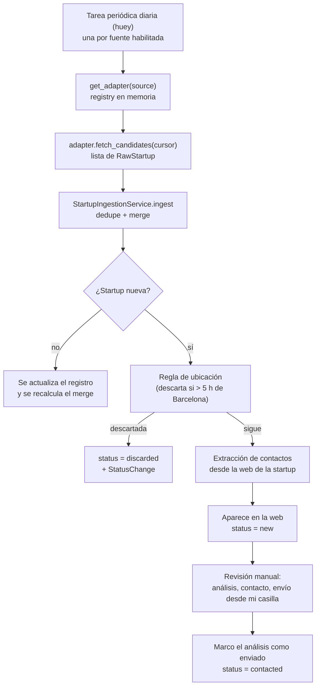
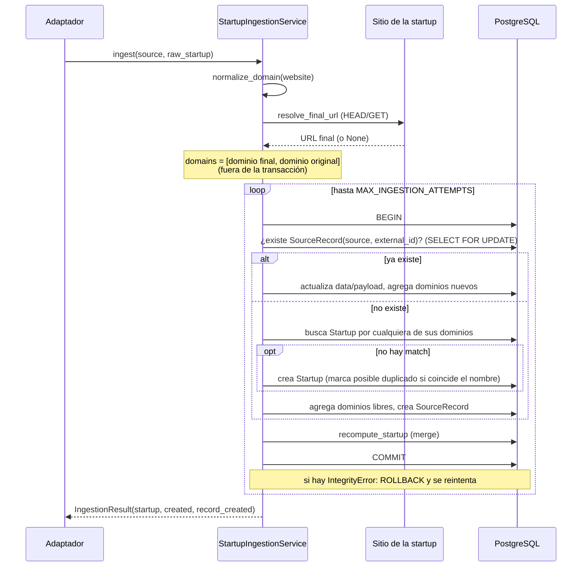
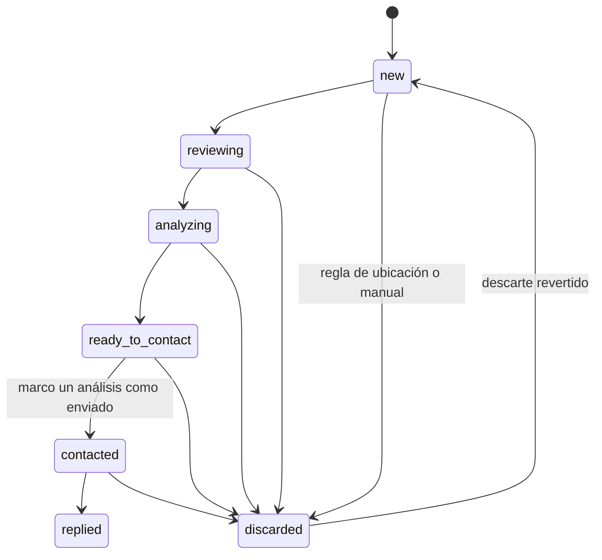

# Arquitectura de startup-scout

Este documento explica qué hace cada parte del código y cómo fluye una startup por el sistema, desde que una fuente la publica hasta que la contacto. Describe el estado al cierre de la **fase 2**. Lo que todavía no existe está marcado como _pendiente_, con la fase en la que llega según el [plan del MVP](startup-scout-design.md#10-plan-del-mvp).

## 1. Vista general

startup-scout tiene una sola responsabilidad: **mantener una lista de startups sin duplicados y con historial**, alimentada por varias fuentes, para que yo las revise y contacte a mano.

El código se organiza en dos apps de Django con responsabilidades separadas:

| App | Responsabilidad | Sabe de… | No sabe de… |
|---|---|---|---|
| `sources` | **De dónde vienen los datos.** Qué fuentes existen, cómo leer cada una y qué reportó cada una | Fuentes, adaptadores, corridas, registros crudos | Cómo se identifica o se fusiona una startup |
| `startups` | **Qué es una startup para nosotros.** Identidad, deduplicación, merge, contactos, análisis y estados | Startups, dominios, merge, ingesta | Cómo se lee cada fuente en particular |

El contrato entre las dos es el dataclass `RawStartup`. Cada adaptador traduce su fuente a `RawStartup`, y la ingesta solo conoce ese formato. Agregar una fuente no toca nada de `startups`.

```
startup-scout/
├── config/                 Settings, URLs y WSGI de Django
├── sources/                App de fuentes
│   ├── adapters/
│   │   ├── base.py         Puerto SourceAdapter + RawStartup + SourceFetchResult
│   │   ├── hacker_news.py  HackerNewsAdapter (API de Algolia)
│   │   └── manual.py       ManualSourceAdapter (alta manual por URL)
│   ├── registry.py         Mapeo en memoria: clave de fuente → adaptador
│   ├── runner.py           SourceRunner: corre una fuente y registra la corrida
│   ├── tasks.py            Tareas de huey: descubrimiento diario y una tarea por fuente
│   ├── management/commands/run_source.py   Correr una fuente a mano
│   ├── models.py           Source, SourceRecord, SourceRun
│   ├── constants.py        SourceKey, SourceRunStatus, parámetros de HN y del scheduler
│   ├── exceptions.py       UnknownSourceError, SourceFetchError
│   ├── migrations/         Esquema, alta de las fuentes y baja de Startupxplore
│   └── tests/              Incluye fixtures/ con respuestas ficticias de Algolia
├── startups/               App de startups
│   ├── domains.py          Normalización de dominios y de nombres
│   ├── redirects.py        Resolución de redirects (HttpRedirectResolver)
│   ├── merge.py            Merge de campos por prioridad de fuente
│   ├── ingestion.py        StartupIngestionService: dedupe + merge + concurrencia
│   ├── models.py           Startup, StartupDomain, Contact, Analysis, StatusChange
│   ├── constants.py        Estados, roles, prioridades, patrones y límites
│   ├── exceptions.py       InvalidWebsiteError, IngestionConflictError
│   ├── migrations/
│   └── tests/
└── docs/
```

## 2. App `sources`

### 2.1 `Source` (modelo)

Una fila por fuente configurada: hoy `hacker_news` y `manual`. Las crea la data migration `0002_seed_initial_sources`. Esa migración también creaba `startupxplore`, y la `0003_remove_startupxplore` la borra (ver §5.3).

| Campo | Para qué |
|---|---|
| `key` | Clave estable y única (`SourceKey`). Es lo único que conecta la fila con el código |
| `name` | Nombre visible en la web |
| `enabled` | Permite apagar una fuente sin borrarla |
| `config` | Parámetros del adaptador en JSON. Por ejemplo, HN usa `{"tags": ["show_hn", "launch_hn"]}` |

**Decisión: en la base nunca se guarda el nombre de una clase.** La `key` se resuelve a un adaptador con un mapeo en memoria (ver 2.5). Así se puede renombrar o mover un adaptador sin tocar los datos, y la base no queda atada a la estructura del código.

### 2.2 `SourceRecord` (modelo)

**Lo que una fuente dijo sobre una startup.** Si una startup aparece en HN y además la cargo a mano, tiene dos `SourceRecord`.

| Campo | Para qué |
|---|---|
| `source`, `external_id` | Identifican el registro dentro de su fuente: el id del post de HN o la URL normalizada en el alta manual. **Únicos juntos**, así una fuente no puede cargar dos veces lo mismo |
| `startup` | A qué startup unificada pertenece |
| `data` | Los campos ya traducidos a nuestro formato (`name`, `website`, `description`, `country`, `city`). **De acá se recalcula el merge** |
| `payload` | La respuesta cruda de la fuente, tal cual llegó. Sirve para depurar y para reprocesar si cambia el mapeo |
| `url` | Link a la startup en la fuente |
| `first_seen_at`, `fetched_at` | Cuándo apareció por primera vez y cuándo se actualizó por última vez |

Guardar los registros por separado, en vez de pisar los datos de la startup, es lo que hace el merge **recalculable**: si cambia la prioridad de las fuentes, se recalcula y listo.

### 2.3 `SourceRun` (modelo)

Una fila por cada vez que corre una fuente: estado (`running`, `succeeded`, `failed`), cuántos ítems vio, cuántos eran nuevos, el error si lo hubo y un `cursor` en JSON para retomar desde donde quedó. Por ejemplo, el último `created_at_i` visto en HN. La corrida siguiente arranca del cursor de la **última corrida exitosa**; una corrida fallida no lo mueve. Sirve como historial y como observabilidad de cada fuente.

### 2.4 `RawStartup` y `SourceAdapter` (`adapters/base.py`)

- **`RawStartup`**: dataclass inmutable con lo que reporta una fuente, ya mapeado a nuestros nombres de campo. `country` llega como código ISO 3166-1 alfa-2 (`ES`), y la conversión es responsabilidad del adaptador. `mergeable_data()` devuelve los campos que entran al merge.
- **`SourceFetchResult`**: lo que devuelve una corrida de un adaptador: la lista de `RawStartup` y el `cursor` desde el que tiene que arrancar la próxima.
- **`SourceAdapter`**: el puerto (ports & adapters). Cada fuente implementa `fetch_candidates(cursor)`, que recibe `{}` en la primera corrida, y devuelve un `SourceFetchResult`. Recibe su `config` desde la fila `Source` y, opcionalmente, un `httpx.Client`; si no se le pasa, lo crea recién cuando lo necesita. En los tests se le inyecta uno con `MockTransport`. `runs_periodically` indica si el descubrimiento diario la corre. Un adaptador solo sabe leer su fuente: no deduplica ni guarda nada. Si no puede leerla, lanza `SourceFetchError`.

### 2.5 `registry.py`

`SOURCE_ADAPTERS` es un diccionario en memoria de `key` a clase de adaptador: hoy `hacker_news → HackerNewsAdapter` y `manual → ManualSourceAdapter`. `get_adapter(source)` busca la clave de la fila y devuelve el adaptador instanciado con su `config`. Si la clave no tiene adaptador, lanza `UnknownSourceError`. `runs_periodically(source)` dice si la fuente entra en el descubrimiento diario. Un test verifica que toda fuente habilitada tenga adaptador.

### 2.6 `HackerNewsAdapter` (`adapters/hacker_news.py`)

Lee posts de la API pública de Algolia (`search_by_date`), sin autenticación.

- **Qué trae**: los `tags` de su `config`, que hoy son `show_hn` y `launch_hn`. "Show HN" es un tag de Algolia. "Launch HN" (startups de YC) no lo es: se busca como texto en `story` y después se filtra por título, porque la búsqueda también trae posts que solo lo mencionan.
- **Cursor**: el `created_at_i` del post más nuevo visto, incluidos los descartados por título. Cada corrida vuelve a leer una hora antes del cursor (`HACKER_NEWS_CURSOR_OVERLAP_SECONDS`), porque Algolia a veces indexa tarde. Repetir posts no duplica nada: se vuelven a ingresar como actualización. Sin cursor, arranca `HACKER_NEWS_INITIAL_LOOKBACK_DAYS` días atrás (7, configurable con `initial_lookback_days`).
- **Paginación**: de a 100 posts por página, hasta `nbPages`.
- **Mapeo a `RawStartup`**:
  - `external_id` es el `objectID` del post, y `url` es el link al post en HN.
  - `name` es el título sin el prefijo, hasta el primer separador (` – `, ` — `, ` - `, `, ` o `: `) y sin el batch de YC (`(YC F26)`). Si el título no tiene separador, el nombre es el título completo, y eso pasa bastante en Show HN.
  - `description` es la frase después del separador. Si no hay, se usa el texto del post en texto plano, hasta 500 caracteres.
  - `website` es el link del post si es un dominio propio. Si es una plataforma (GitHub, App Store, YouTube…), se usa el primer dominio propio que aparezca linkeado en el texto. Si no hay ninguno, se deja el link a la plataforma, que no identifica a la startup (ver §3.6).
  - `raw_payload` es el hit completo, sin `_highlightResult`. Incluye `author`, que en la fase 4 será el candidato a contacto.

### 2.7 `ManualSourceAdapter` (`adapters/manual.py`)

No corre periódicamente: su `fetch_candidates` no trae nada. Expone `build_raw_startup(website, name="")`, que va a usar el formulario de alta manual de la web (fase 5):

- `external_id` es la URL normalizada (`acme.com/pricing`), así pegar dos veces el mismo sitio actualiza el mismo registro.
- Si no se da un nombre, usa el del dominio (`acme.com` → `Acme`).
- Si la URL no tiene dominio registrable, lanza `InvalidWebsiteError`.

### 2.8 `SourceRunner` (`runner.py`)

Corre una fuente de punta a punta:

1. Crea un `SourceRun` en `running`.
2. Toma el cursor de la última corrida exitosa.
3. Pide los candidatos al adaptador. Si falla (`SourceFetchError` o `UnknownSourceError`), cierra la corrida en `failed` con el error, y el cursor no se mueve.
4. Ingresa cada `RawStartup` con `StartupIngestionService`. Si una startup falla, el error queda anotado en `error` y la corrida sigue con las demás.
5. Guarda `items_seen`, `items_new` (startups **creadas**, no registros) y el cursor nuevo, y cierra en `succeeded`.

### 2.9 Tareas y comando (`tasks.py`, `run_source`)

- **`run_enabled_sources_task`**: tarea periódica de huey, todos los días a las 7:00 hora de Madrid (`DISCOVERY_HOUR`). Encola una `run_source_task` por cada fuente habilitada con `runs_periodically`, así una fuente que falla no frena a las otras.
- **`run_source_task(source_id)`**: corre `SourceRunner` dentro de un lock de huey (`source-run-<key>`), para que dos corridas de la misma fuente no lean el mismo cursor a la vez. Si ya hay una corriendo, la nueva se saltea.
- **`python manage.py run_source <key>`**: corre una fuente en el momento, fuera del horario. Sirve para probar o para forzar una corrida.

## 3. App `startups`

### 3.1 `Startup` (modelo)

La startup **unificada**: una sola fila por startup real, venga de las fuentes que venga.

| Campo | Para qué |
|---|---|
| `name`, `website`, `description`, `country`, `city` | Valores **calculados por el merge** a partir de los `SourceRecord`. No se editan directo: una edición manual será un registro de la fuente `manual`, que tiene la prioridad más alta |
| `field_sources` | De qué fuente salió cada campo, por ejemplo `{"name": "manual", "description": "hacker_news"}` |
| `normalized_name` | Nombre comparable (sin tildes, puntuación ni "S.L."/"Inc."). Indexado, se usa para detectar posibles duplicados |
| `possible_duplicate_of` | Si se sospecha que es la misma que otra startup. **Nunca se fusionan solas**: lo confirmo yo desde la web (fase 5) |
| `status` | En qué punto del proceso está (ver §5.4) |
| `discard_reason` | Por qué se descartó: regla de ubicación o descarte manual |
| `remote_policy` | `unknown`, `remote`, `hybrid` u `onsite`. Lo usa la regla de ubicación (fase 3) |
| `first_seen_at` | Cuándo la descubrimos. El listado ordena por este campo, de la más nueva a la más vieja |

### 3.2 `StartupDomain` (modelo)

**La identidad de la startup.** Cada startup tiene uno o más dominios normalizados y uno de ellos es el principal (`is_primary`). Los demás son alias, por ejemplo el dominio desde el que redirige su web. `domain` es **único en toda la tabla**: es el constraint que garantiza que no haya dos startups con el mismo dominio, incluso con ingestas concurrentes.

### 3.3 `Contact` (modelo)

Personas o canales para contactar a la startup: CEO, CTO, founder, otro cargo o un contacto general como `hello@`. Registra cómo se encontró (`found_via`: la fuente, la web de la startup o carga manual), la URL donde aparece (`evidence_url`) y su estado (`candidate`, `confirmed` o `rejected`). Los candidatos se confirman a mano. _El modelo existe; la extracción desde la web de la startup llega en la fase 4._

### 3.4 `Analysis` (modelo)

Mis análisis de una startup, en markdown. Puede haber varios por startup. "Enviado" significa `sent_at` no nulo (propiedad `is_sent`); `sent_to` apunta al contacto al que se lo mandé. _El modelo existe; el CRUD en la web llega en la fase 5._

### 3.5 `StatusChange` (modelo)

El historial de cambios de estado de cada startup: estado anterior, estado nuevo, una nota y la fecha. Lo escriben los cambios manuales y las reglas automáticas, como el descarte por ubicación o el paso a `contacted` al marcar un análisis como enviado. _Se empieza a escribir en las fases 3 y 5._

### 3.6 `domains.py`

- **`normalize_domain(website)`**: de cualquier URL o host obtiene su **dominio registrable**. Ejemplos: `https://www.Acme.com/pricing` → `acme.com`, `app.acme.com` → `acme.com`, `www.müller.de` → `xn--mller-kva.de`.
  - Usa la Public Suffix List **con los sufijos privados**, así `foo.vercel.app` y `bar.vercel.app` siguen siendo distintos.
  - La lista viene incluida en `tldextract`: no hay acceso a red ni caché en disco, y el resultado es determinístico.
  - **Hosts compartidos** que no están en la Public Suffix List (`substack.com`, `medium.com`, `itch.io`, `gitbook.io`, `wordpress.com`, etc.: `SHARED_HOST_DOMAINS`): se conserva el subdominio, así `acme.substack.com` identifica a Acme.
  - Si el valor no tiene un dominio registrable (vacío, IP, `localhost` o texto que no es una URL), lanza `InvalidWebsiteError`.
- **`is_identifying_domain(domain)`**: dice si un dominio identifica a **una** startup. Es falso para las plataformas donde el link apunta a contenido adentro (`github.com`, `apple.com`, `google.com`, `youtube.com`, `x.com`, `producthunt.com`…, en `NON_IDENTIFYING_DOMAINS`) y para un host compartido sin subdominio. Sin esto, todos los Show HN que linkean a GitHub terminarían fusionados en una sola startup llamada `github.com`.
- **`normalize_url(website)`**: forma comparable de una URL completa: host sin `www.`, más el path (`acme.com/pricing`). La usa el alta manual como `external_id`.
- **`normalize_name(name)`**: forma comparable de un nombre. `"Ácme, S.L.U."` → `"acme"`. Saca tildes, puntuación, mayúsculas y sufijos legales del final (la lista está en `LEGAL_NAME_SUFFIXES`), pero deja siempre al menos una palabra.

### 3.7 `redirects.py`

`HttpRedirectResolver.resolve_final_url(url)` sigue los redirects de un sitio y devuelve la URL final, o `None` si el sitio no responde. Primero prueba con `HEAD`; si el servidor lo rechaza (403, 405, 501), reintenta con `GET` en streaming, sin descargar el cuerpo. Es una dependencia inyectable: en los tests se reemplaza por `FakeRedirectResolver`, sin red.

### 3.8 `merge.py`

- **`merge_source_data(records)`**: función pura. Recibe pares `(source_key, data)` y, **campo por campo**, se queda con el primer valor no vacío según `SOURCE_MERGE_PRIORITY` (`manual > hacker_news`). Las fuentes que no están en la lista van al final. Devuelve los valores y la procedencia de cada uno.
- **`recompute_startup(startup)`**: lee todos los `SourceRecord` de la startup, aplica el merge y guarda los campos, `normalized_name` y `field_sources`. Es idempotente: correrlo dos veces da lo mismo.

### 3.9 `ingestion.py`: `StartupIngestionService`

El corazón de la fase 1. `ingest(source, raw_startup)` convierte lo que reporta una fuente en una startup única, y devuelve un `IngestionResult(startup, created, record_created)`. El paso a paso está en §5.2.

## 4. Configuración relevante

| Setting / constante | Dónde | Para qué |
|---|---|---|
| `REFERENCE_TIMEZONE`, `HOME_COUNTRY` | `config/settings.py` (`.env`) | Regla de ubicación: `Europe/Madrid` y `ES` (fase 3) |
| `HUEY` | `config/settings.py` | Cola de tareas en Redis. `HUEY_IMMEDIATE=true` corre las tareas en línea, como en la CI |
| `SOURCE_MERGE_PRIORITY` | `startups/constants.py` | Orden de confianza entre fuentes para el merge |
| `MAX_INGESTION_ATTEMPTS` | `startups/constants.py` | Reintentos ante choques de concurrencia (3) |
| `REDIRECT_TIMEOUT_SECONDS` | `startups/constants.py` | Timeout al resolver redirects (10 s) |

## 5. Proceso / pipeline

### 5.1 Vista de punta a punta



| Paso | Estado |
|---|---|
| Tarea periódica, runner, `SourceRun` y adaptadores de HN y alta manual | **Implementado (fase 2)** |
| `get_adapter` / registro | **Implementado** |
| Ingesta: dedupe, merge y concurrencia | **Implementado (fase 1)** |
| Regla de ubicación | Pendiente (fase 3) |
| Extracción de contactos | Pendiente (fase 4) |
| Web: listado, ficha, análisis, estados | Pendiente (fase 5) |

### 5.2 Ingesta de una startup (implementado)



Paso a paso:

1. **Dominios (fuera de la transacción).** Se normaliza el `website`. Si no tiene dominio registrable, o si el dominio es de una plataforma (`is_identifying_domain`), la startup se ingresa sin dominio; el `website` igual queda guardado. Un redirect hacia una plataforma tampoco se usa como alias. Después se resuelven los redirects: si la web redirige a otro dominio (`acme.io` → `acme.com`), los dos identifican a la startup y el destino queda como principal. La llamada de red va antes de abrir la transacción para que esta sea corta.
2. **¿Ya conocemos este registro?** Se busca `SourceRecord(source, external_id)` con `SELECT FOR UPDATE`. Si existe, es una re-ingesta: se actualizan `data` y `payload`, se agregan los dominios nuevos y se recalcula el merge. No se crea nada.
3. **¿Ya conocemos la startup?** Se busca una startup que tenga **cualquiera** de los dominios.
   - Si hay una, se usa esa.
   - Si los dominios apuntan a dos startups distintas (por ejemplo, se cargaron `acme.io` y `acme.com` por separado y ahora sabemos que una redirige a la otra), se usa la más antigua y la otra queda marcada `possible_duplicate_of`. **No se fusionan solas.**
4. **Startup nueva.** Si no hubo match, se crea. Si su nombre normalizado coincide con el de otra startup existente, queda marcada como posible duplicado. Esto cubre sobre todo las startups sin web: el nombre solo marca, nunca fusiona, porque dos empresas pueden llamarse igual.
5. **Dominios y registro.** Se agregan los dominios que no tenga otra startup (el primero es el principal) y se crea el `SourceRecord`.
6. **Merge.** `recompute_startup` recalcula todos los campos a partir de todos los registros.
7. **Concurrencia.** Si dos ingestas de la misma startup corren a la vez (dos fuentes o dos workers), ambas pueden no encontrar nada y tratar de crearla. Los constraints únicos (`StartupDomain.domain` y `(source, external_id)`) hacen que una falle con `IntegrityError`. Su transacción se deshace entera, se reintenta, y en el reintento ya encuentra la startup de la otra y se suma como un registro más. Después de `MAX_INGESTION_ATTEMPTS` intentos fallidos lanza `IngestionConflictError`.

### 5.3 Descubrimiento por fuente (implementado, fase 2)

- **Hacker News**: ver §2.6. Una corrida real del último día trajo 205 posts y dio 204 startups (dos posts eran de la misma empresa). Unas 60 quedaron sin dominio porque solo linkean a GitHub. Show HN trae mucho ruido, como esperábamos.
- **Alta manual**: el adaptador ya arma el `RawStartup` (§2.7). El formulario llega en la fase 5 y usa la misma ingesta.
- **Startupxplore: descartada y eliminada.** Sus términos de uso prohíben reproducir su base de datos sin consentimiento escrito. La migración `0003_remove_startupxplore` borra la fuente (y sus registros, si los hubiera) y la saca de los choices de `SourceKey`. El detalle está en [Fuentes descartadas](startup-scout-design.md#fuentes-descartadas), junto con EU-Startups.

### 5.4 Estados de una startup



Todos los cambios son manuales, salvo el descarte por ubicación y el paso a `contacted` al marcar un análisis como enviado. Cada cambio deja un `StatusChange`.

## 6. Tests

Cada app tiene sus tests en `<app>/tests/`, con sus propios fakes:

| Archivo | Cubre |
|---|---|
| `sources/tests/test_registry.py` | Fuentes creadas por las migraciones (solo HN y manual); toda fuente habilitada tiene adaptador; `get_adapter`, `runs_periodically`, `UnknownSourceError` |
| `sources/tests/test_hacker_news_adapter.py` | Mapeo de Show HN y Launch HN, elección del sitio propio sobre GitHub, filtro por título, cursor con solapamiento, tags desconocidos, errores de la API. Usa `fixtures/` con datos ficticios |
| `sources/tests/test_manual_adapter.py` | Alta por URL, nombre por defecto, mismo sitio pegado dos veces, URL inválida |
| `sources/tests/test_runner.py` | Corrida exitosa, cursor de la última corrida exitosa, fetch fallido, una startup que falla no corta la corrida |
| `sources/tests/test_tasks.py` | El descubrimiento diario solo encola fuentes habilitadas y periódicas; la tarea por fuente usa el runner |
| `startups/tests/test_domains.py` | Normalización de dominios (www, subdominios, PaaS, IDN, hosts compartidos, inválidos), plataformas que no identifican y nombres |
| `startups/tests/test_redirects.py` | Redirects con `httpx.MockTransport`: cadena de redirects, fallback a GET, sitio caído, esquema faltante |
| `startups/tests/test_merge.py` | Prioridad por campo, la fuente manual siempre gana, valores vacíos, fuentes desconocidas |
| `startups/tests/test_ingestion.py` | Dedupe entre fuentes, alias por redirect, re-ingesta, merge, posibles duplicados por nombre o por dominios cruzados, web inválida, links a plataformas |
| `startups/tests/test_ingestion_concurrency.py` | Ingestas simultáneas en varios hilos contra Postgres real: una sola startup y ningún error |

Los tests no usan la red. Los de concurrencia usan `transaction=True` y `serialized_rollback=True`, para que la data migration de las fuentes siga disponible para los tests siguientes.
