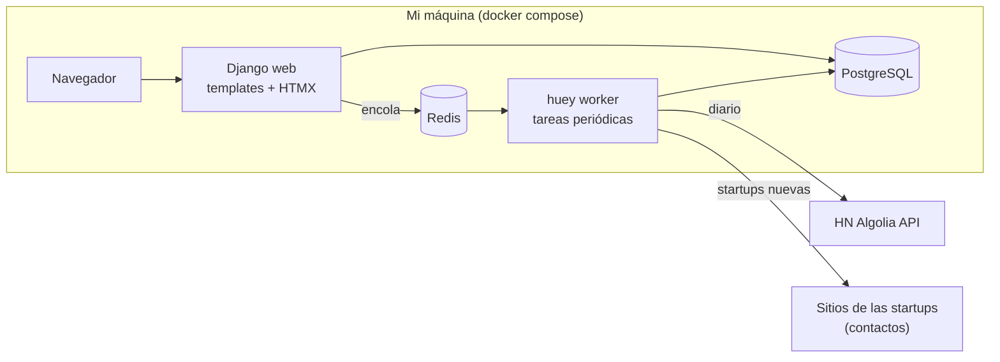

# startup-scout: diseño v3 y plan del MVP

Fecha: 2026-11-18 · Repo público

## 1. Qué es

Un **descubridor de startups con historial**. Cada día trae startups nuevas de unas pocas fuentes y las muestra en una web, con el sitio y los contactos que publica la propia startup (CEO, founder o algún contacto general).

Yo reviso el producto y escribo mis análisis desde la misma web: crearlos, editarlos, eliminarlos y marcarlos como enviados. Cuando estoy conforme, le escribo a esa persona desde mi casilla. El envío queda fuera de la app.

**Costo del MVP: $0.** Sin IA, sin APIs pagas y corriendo local.

**Fuera del MVP (mejoras futuras):**
- IA de cualquier tipo, ni siquiera a demanda: análisis preliminar, borrador de mail, `web_search`.
- Buscadores externos (Brave u otros).
- EU-Startups y cualquier otra fuente.
- Perfil del candidato, envío de mails y deploy.

## 2. Fuentes del MVP

Verificado el 2026-11-18.

| Fuente | Resultado | Integración |
|---|---|---|
| **Hacker News** | API pública de Algolia (`hn.algolia.com/api/v1`), sin autenticación | **API**. Se traen "Show HN" y "Launch HN" (startups de YC). El autor del post suele ser el founder |
| **Alta manual** | n/a | Formulario en la web: pego una URL y se crea la ficha, pasando por el dedupe |

Riesgos:
- Show HN trae ruido (proyectos personales, librerías). Como no se filtra, la web tiene que permitir descartar rápido.
- El MVP tiene una sola fuente automática (HN) más el alta manual. Las startups españolas o europeas van a llegar sobre todo por alta manual, hasta sumar otra fuente.

### Fuentes descartadas

| Fuente | Fecha | Motivo |
|---|---|---|
| **EU-Startups** | 2026-11-18 | Todo el dominio (sitio, robots.txt, feed RSS y API de WordPress) está detrás de un challenge de Cloudflare, y no tiene API oficial. Esquivar esa protección no es una opción |
| **Startupxplore** | 2026-11-18 | Su robots.txt permite el acceso, pero sus **términos de uso (cláusulas 7.3 y 7.4) prohíben reproducir su base de datos, total o parcialmente, y usar su contenido sin consentimiento previo y por escrito**. Además, el sitio hoy está orientado al crowdfunding y el sitemap del directorio es de 2018. Se eliminó del código: la migración `sources/0003_remove_startupxplore` borra la fuente y la saca de los choices de `SourceKey`. Volver a sumarla requeriría su consentimiento escrito y un adaptador nuevo |

Lección para fuentes futuras: **robots.txt no alcanza**. Antes de escribir un adaptador HTML hay que leer los términos de uso del sitio.

### Fuentes en la base y mapeo en memoria

- La tabla `Source` guarda cada fuente con una **clave estable** (`key`, slug único: `hacker_news`, `manual`), un nombre visible, `enabled` y su `config` (JSON).
- En código, `sources/registry.py` tiene un mapeo en memoria `SOURCE_ADAPTERS = {"hacker_news": HackerNewsAdapter, ...}`. Las claves van como constantes en `sources/constants.py`.
- Para correr una fuente se lee el `Source` de la base, se busca su `key` en el mapeo y se instancia el adaptador con su `config`. **En la base nunca se guarda el nombre de una clase**: si se renombra o se mueve un adaptador, la base no se entera.
- Si una `key` de la base no está en el mapeo, se lanza `UnknownSourceError` (en `exceptions.py`). Un test verifica que todas las fuentes sembradas tengan adaptador.
- Las fuentes se crean con una data migration.

## 3. Única regla de descarte automático: ubicación

Referencia: **Barcelona**, es decir `REFERENCE_TIMEZONE = "Europe/Madrid"` (en IANA no existe una zona propia para Barcelona) y `HOME_COUNTRY = "ES"`.

- **Zona horaria**: se descarta si la diferencia con Barcelona es mayor a 5 h.
  - El horario de verano cambia en fechas distintas según el país, así que la diferencia se calcula en dos fechas fijas (15 de enero y 15 de julio) y se usa **la menor**.
  - En países con varias zonas se usa la más cercana.
  - Ejemplos: Reino Unido 1 h (queda), Argentina 4–5 h (queda), costa este de EE.UU. 6 h (se descarta).
- **País distinto y sin remoto**: se descarta solo si la startup no es de España **y** se sabe que no admite remoto. Al descubrirla, `remote_policy` casi siempre es `unknown`, y en ese caso no se descarta.
- **Ubicación desconocida**: no se descarta; se marca para que la vea.
- El descarte es **reversible**, guarda el motivo y queda en el historial. Las descartadas se ven con un filtro.
- La regla es determinística: de país a zonas horarias con `zoneinfo`.

## 4. Deduplicación y merge entre fuentes

Una startup existe **una sola vez**, venga de las fuentes que venga.

**Clave de identidad: dominio normalizado**
- Sin esquema, sin `www.`, sin path, en minúsculas y con IDNA.
- Dominio registrable con `tldextract`, **incluyendo los sufijos privados de la Public Suffix List**. Así `foo.vercel.app` y `bar.vercel.app` (o `github.io`, `netlify.app`) quedan como startups distintas.
- Al ingresar se siguen los redirects una vez (por ejemplo `abc.io` → `abc.com`) y se guardan ambos dominios como alias. Una startup matchea por cualquiera de ellos.

**Sin sitio web**
- Si el nombre normalizado coincide (sin tildes, sin "S.L.", "Inc."), **no se fusiona automáticamente**. Se crea la ficha marcada como "posible duplicado" y la fusión la confirmo desde la web. Un falso merge es peor que un duplicado visible.

**Merge**
- Se guarda el registro crudo de cada fuente (`SourceRecord`). La ficha unificada se **recalcula** a partir de esos registros, así que el merge es determinístico e idempotente.
- Prioridad por campo, en `constants.py`: `manual > hacker_news`. Gana el primer valor no vacío; lo que edito a mano siempre gana.
- Se guarda la procedencia de cada campo (`field_sources`).

**Concurrencia**
- Constraint `UNIQUE` sobre `StartupDomain.domain` y sobre `(source, external_id)` en `SourceRecord`.
- El get-or-create se hace dentro de una transacción. Si dos fuentes traen la misma startup al mismo tiempo, una gana y la otra captura el `IntegrityError` y reintenta como merge.

## 5. Contactos: desde la web de la startup

Sin buscadores. Para cada startup **nueva y no descartada**, una tarea en segundo plano visita su sitio y extrae contactos con reglas determinísticas, sin IA:

1. **Qué páginas visita**: la home y unas pocas rutas típicas (`/about`, `/about-us`, `/team`, `/contact`, `/nosotros`, `/equipo`, `/quienes-somos`, `/contacto`), más los links de la home que apunten a ellas. Como máximo ~8 páginas por sitio.
2. **Qué extrae**:
   - links `mailto:`;
   - links a perfiles de LinkedIn (solo se guarda la URL, LinkedIn nunca se visita);
   - JSON-LD de schema.org (`founder`, `employee`, `Person` con `jobTitle`);
   - nombres cerca de cargos como "CEO", "Founder", "Co-founder", "CTO", "Fundador" o "Cofundador".
3. **Cómo lo guarda**: cada hallazgo es un `Contact` con `status=candidate`, la URL de la página como evidencia y un tipo: persona con cargo o contacto general (`hello@`, `info@`, formulario).
4. **HN**: el autor del post queda como candidato, con link a su perfil de HN.

Hay que ser honesto con esto: es heurístico. Muchos sitios no publican al equipo, y ahí quedará solo un contacto general o nada. Para eso la ficha permite cargar el contacto a mano.

**Buenas prácticas:**
- Se respeta el robots.txt de cada sitio.
- Un request a la vez por dominio, con timeout y un User-Agent identificable.
- Se guardan solo datos profesionales publicados por la propia startup.
- La base nunca se commitea; los tests usan HTML ficticio.

## 6. Análisis (desde la web)

Formulario simple, sin estilos especiales: un `textarea` en markdown que se renderiza al mostrarlo.

- **Crear**: "Nuevo análisis" en la ficha. Se guarda al enviar el formulario.
- **Editar**: cualquiera, enviado o no.
- **Eliminar**: con confirmación. Es un borrado real; si el análisis ya estaba enviado, la confirmación lo avisa.
- **Marcar como enviado**: con la fecha (hoy por defecto) y, si quiero, el contacto al que se lo mandé. Si la startup no estaba en `contacted`, pasa a ese estado y queda en el historial. Se puede desmarcar, por si lo marqué por error.
- Puede haber varios por startup, del más nuevo al más viejo, con su estado (borrador o enviado).

## 7. Arquitectura e infraestructura

**Código**
- Fuentes como ports & adapters: el puerto es `SourceAdapter.fetch_candidates(since) -> list[RawStartup]` y el mapeo de `key` a adaptador vive en memoria (§2).
- Frontend: Django templates + HTMX, server-side, sin build de JS. CSS mínimo (Pico.css por CDN).
- Constantes en `constants.py`, excepciones en `exceptions.py`, sin inner functions y todo el código en inglés.

**Costos**

| Concepto | Costo |
|---|---|
| HN Algolia, sitios de las startups | Gratis |
| Postgres, Redis, huey | Gratis (local, docker compose) |
| GitHub (repo público) + Actions | Gratis |
| Hosting | $0 mientras corra local. El deploy queda como mejora futura |

## 8. Modelo de datos

- `Source`: key (slug único), name, enabled, config (JSON), created_at.
- `Startup`: name, normalized_name (para detectar posibles duplicados), website, description, country, city, remote_policy (`unknown|remote|hybrid|onsite`), status, discard_reason, possible_duplicate_of (FK nullable), field_sources (JSON), first_seen_at, updated_at.
- `StartupDomain`: startup, domain (unique), is_primary.
- `SourceRecord`: startup, source (FK `Source`), external_id, url, data (JSON: los campos ya mapeados, de donde se recalcula el merge), payload (JSON crudo de la fuente), first_seen_at, fetched_at. Unique en `(source, external_id)`.
- `SourceRun`: source (FK `Source`), started_at, finished_at, status, items_seen, items_new, error, cursor (JSON: el último `created_at` de HN o el set de URLs del sitemap).
- `Contact`: startup, full_name, role (`ceo|cto|founder|other|general`), email, profile_url, found_via (`source|website|manual`), evidence_url, status (`candidate|confirmed|rejected`).
- `Analysis`: startup, title, body (markdown), sent_at (nullable), sent_to (FK `Contact`, nullable), created_at, updated_at.
- `StatusChange`: startup, from_status, to_status, note, changed_at.

**Estados de la startup**: `new → reviewing → analyzing → ready_to_contact → contacted → replied`, más `discarded` desde cualquier estado. Todos los cambios son manuales, salvo el descarte por ubicación y el paso a `contacted` al marcar un análisis como enviado.

## 9. Pantallas

- **Listado**: las más nuevas primero. Filtros por estado, fuente, país, "tiene contacto" y fecha; búsqueda por texto. Descarte rápido con motivo.
- **Ficha**: datos unificados con la procedencia de cada campo, dominios, registros de cada fuente, contactos (confirmar, rechazar o cargar a mano), análisis (crear, editar, eliminar, marcar o desmarcar como enviado) e historial de estados.
- **Alta manual**: pegar una URL.
- **Fusionar duplicados**: dos fichas lado a lado y confirmar.
- **Corridas**: últimas corridas por fuente, con vistas, nuevas y errores.

## 10. Plan del MVP

Cada fase arranca por los tests de los casos de uso (TDD) y cierra con una revisión antes del PR.

| Fase | Entregable | Terminado cuando |
|---|---|---|
| 0. Setup | Django + Postgres + Redis + huey en docker compose; ruff y pytest; GitHub Actions; README, LICENSE y `.env.example` | `docker compose up` levanta todo y la CI pasa |
| 1. Dominio | Modelos, `Source` con data migration y registro en memoria, normalización de dominios, ingesta con dedupe, merge por prioridad y concurrencia | Tests de dedupe (www, subdominios, PaaS, redirects, mismo nombre sin web, ingestas concurrentes) y de `UnknownSourceError` |
| 2. Fuentes ✅ | Adaptadores de HN (Algolia) y de alta manual; runner con `SourceRun`; tareas periódicas; comando `run_source`. Startupxplore se descartó por sus términos (§2) | Corridas diarias que traen startups reales sin duplicados; los tests usan fixtures ficticios, sin red |
| 3. Regla de ubicación | País → zonas horarias contra `Europe/Madrid`; descarte reversible con motivo | Tests por país: multi-zona, horario de verano, desconocido, sin remoto |
| 4. Contactos | Extractor desde la web de la startup (mailto, LinkedIn, JSON-LD, cargos) y autor de HN; respeto de robots.txt | Las startups nuevas aparecen con candidatos y evidencia; tests con HTML ficticio |
| 5. Frontend | Listado, ficha, contactos, CRUD de análisis con marca de enviado, estados e historial, alta manual, fusión de duplicados, corridas | Todo el flujo manual se hace desde la web |

**MVP terminado** cuando corre una semana solo, descubriendo cada día, y yo hago el ciclo completo con al menos una startup: la reviso, escribo el análisis, tomo el contacto de la ficha, se lo mando desde mi casilla y lo marco como enviado.
