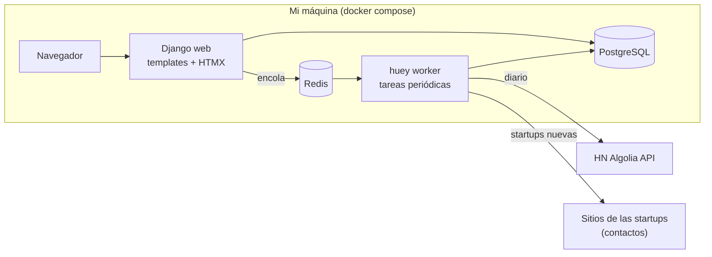

# startup-scout: diseño v3 y plan del MVP

Fecha: 2026-11-18 · Repo público

## 1. Qué es

Un **descubridor de startups con historial**. Cada día trae startups nuevas de unas pocas fuentes y las muestra en una web, con el sitio y los contactos que publica la propia startup (CEO, founder o algún contacto general).

Yo reviso el producto y escribo mis análisis desde la misma web: crearlos, editarlos, eliminarlos y marcarlos como enviados. Cuando estoy conforme, le escribo a esa persona desde mi casilla. El envío queda fuera de la app.

**Costo del MVP: $0.** Sin IA, sin APIs pagas y corriendo local.

**Fuera del MVP (mejoras futuras):**
- IA de cualquier tipo, ni siquiera a demanda: análisis preliminar, borrador de mail, `web_search`.
- Buscadores externos (Brave u otros).
- EU-Startups y cualquier otra fuente.
- Perfil del candidato, envío de mails y deploy.
- Detección de país y regla de ubicación (descarte automático por zona horaria).

## 2. Fuentes del MVP

Verificado el 2026-11-18.

| Fuente | Resultado | Integración |
|---|---|---|
| **Hacker News** | API pública de Algolia (`hn.algolia.com/api/v1`), sin autenticación | **API**. Se traen "Show HN" y "Launch HN" (startups de YC). El autor del post suele ser el founder |
| **HN Who is hiring** | La misma API de Algolia | **API**. Cada comentario de primer nivel del hilo mensual "Ask HN: Who is hiring?" es una empresa que está contratando (ver abajo). Agregada el 2026-11-19 |
| **Alta manual** | n/a | Formulario en la web: pego una URL y se crea la ficha, pasando por el dedupe |

Riesgos:
- Show HN trae ruido (proyectos personales, librerías). Como no se filtra, la web tiene que permitir descartar rápido.
- Show HN trae sobre todo proyectos personales que no contratan: de ~370 startups, solo 14 mostraban búsquedas en su web. Por eso se sumó "Who is hiring?", donde la búsqueda abierta es la razón por la que la empresa aparece.
- Las fuentes automáticas son las dos de HN. Las startups españolas o europeas van a llegar sobre todo por alta manual, hasta sumar otra fuente.

### HN Who is hiring

El usuario `whoishiring` publica el hilo el primer día hábil de cada mes. Medido sobre los hilos de octubre y noviembre de 2026: ~245 comentarios de primer nivel por mes, el 89 % con el encabezado `Empresa | Rol | Ubicación | REMOTE`, y el 70-75 % con un link al dominio propio de la empresa.

- **Qué lee**: los hilos de los últimos 45 días (los comentarios siguen llegando después del día 1) y, de cada uno, los comentarios de primer nivel. Las respuestas son conversaciones y se ignoran. La primera corrida lee solo el hilo más nuevo.
- **Nombre**: el primer segmento del encabezado, sin paréntesis (`Lumbre Labs (YC W26)` → `Lumbre Labs`). Si la primera línea no tiene `|`, no es un aviso y se descarta.
- **Descripción**: el encabezado completo (rol, ubicación, remoto). La ubicación no se parsea: el país sigue fuera del MVP.
- **Web**, por confianza decreciente: (1) un link cuyo dominio coincide con el nombre de la empresa; (2) un link propio en el encabezado; (3) el dominio de un mail del aviso, salvo que sea un proveedor de correo (gmail, outlook…). Si nada de eso aparece, el aviso se descarta. **Nunca se toma "el primer link"**: notas de prensa, formularios o papers fusionarían empresas distintas bajo un mismo dominio. Por eso las plataformas de búsqueda (Ashby, Greenhouse, Workday…), los formularios (Typeform, Tally) y la prensa (TechCrunch…) no identifican a una startup.
- **Prioridad en el merge**: la más baja. Si la empresa vino por Show HN, su tagline describe mejor el producto que "Senior Engineer | Remote".
- **Límites**: se pierden los avisos que solo linkean a una plataforma de búsqueda (11-16 %); si alguien edita su aviso después (por ejemplo, "CLOSED"), no se relee; también postean empresas grandes, que no se filtran.

### Fuentes descartadas

| Fuente | Fecha | Motivo |
|---|---|---|
| **EU-Startups** | 2026-11-18 | Todo el dominio (sitio, robots.txt, feed RSS y API de WordPress) está detrás de un challenge de Cloudflare, y no tiene API oficial. Esquivar esa protección no es una opción |
| **Startupxplore** | 2026-11-18 | Su robots.txt permite el acceso, pero sus **términos de uso (cláusulas 7.3 y 7.4) prohíben reproducir su base de datos, total o parcialmente, y usar su contenido sin consentimiento previo y por escrito**. Además, el sitio hoy está orientado al crowdfunding y el sitemap del directorio es de 2018. Se eliminó del código: la migración `sources/0003_remove_startupxplore` borra la fuente y la saca de los choices de `SourceKey`. Volver a sumarla requeriría su consentimiento escrito y un adaptador nuevo |
| **yc-oss/api** | 2026-11-19 | JSON gratuito con las empresas de YC y un campo `isHiring`, pero **no es oficial**: sale del índice de Algolia que usa el sitio de YC, no de una API que YC ofrezca. Es la misma zona gris que Startupxplore. Además Launch HN ya cubre parte de YC |
| **Remotive, RemoteOK, We Work Remotely** | 2026-11-19 | Son bolsas de empleo, no fuentes de startups, y sus APIs públicas ponen condiciones de uso (atribución, pocas consultas por día) |

Pendiente: **Work at a Startup (YC)** requiere login; queda por investigar si hay una forma permitida de usarla.

Lección para fuentes futuras: **robots.txt no alcanza**. Antes de escribir un adaptador HTML hay que leer los términos de uso del sitio.

### Fuentes en la base y mapeo en memoria

- La tabla `Source` guarda cada fuente con una **clave estable** (`key`, slug único: `hacker_news`, `hacker_news_hiring`, `manual`), un nombre visible, `enabled` y su `config` (JSON).
- En código, `sources/registry.py` tiene un mapeo en memoria `SOURCE_ADAPTERS = {"hacker_news": HackerNewsAdapter, ...}`. Las claves van como constantes en `sources/constants.py`.
- Para correr una fuente se lee el `Source` de la base, se busca su `key` en el mapeo y se instancia el adaptador con su `config`. **En la base nunca se guarda el nombre de una clase**: si se renombra o se mueve un adaptador, la base no se entera.
- Si una `key` de la base no está en el mapeo, se lanza `UnknownSourceError` (en `exceptions.py`). Un test verifica que todas las fuentes sembradas tengan adaptador.
- Las fuentes se crean con una data migration.

## 3. Señal de búsquedas abiertas (fase 3)

**Objetivo:** marcar las startups cuya web sugiere que están contratando, porque son las que reviso primero. Es lo único que se detecta en esta etapa.

**Postergado:** la detección de país y la regla de ubicación. HN no informa el país, y detectarlo desde la web suma complejidad para poco peso. Ninguna startup se descarta automáticamente por ahora. Los campos `country` y `remote_policy` siguen existiendo y se pueden cargar a mano.

### Estrategia: la home primero, rutas típicas como fallback

1. **Principal: la home (1 request).** Se descarga el HTML de la home y se analiza **completo**. La navegación de arriba y el footer de abajo vienen en el mismo documento, y son justamente donde suelen estar los links a "Careers" o "Jobs". Busca:
   - **Links** cuyo texto o URL coincida con los patrones de búsqueda (abajo).
   - **Links a plataformas de búsqueda** (abajo).
   - **Frases** de búsqueda en el texto visible ("We're hiring", "Estamos contratando").
2. **Fallback: rutas típicas (hasta 4 requests).** Solo si la home no dio señal: `/careers`, `/jobs`, `/join-us` y `/trabaja-con-nosotros`, en ese orden, deteniéndose en la primera que dé señal. Una ruta cuenta solo si:
   - responde 200,
   - **no** termina redirigiendo a la home (muchas webs mandan cualquier ruta inexistente a la home),
   - y su contenido tiene alguna palabra de búsqueda.

¿Por qué este orden? La home resuelve la mayoría de los casos con un solo request. El fallback cubre las webs donde el link no está en la home, o donde la home se arma con JavaScript y el HTML inicial viene casi vacío. Así no se le hacen requests de más a los sitios que ya mostraron la señal.

### Qué cuenta como señal

- **Links fuertes**: una URL con `careers`, `jobs`, `join-us`, `join-the-team`, `work-with-us`, `open-positions`, `empleo`, `trabaja-con-nosotros`, `unete` o `vacantes` en el path, o un texto de link como "Careers", "Jobs", "Join the team", "Join our team", "Work with us", "Open positions", "Open roles", "Trabaja con nosotros", "Únete al equipo", "Empleo" o "Vacantes".
- **Plataformas de búsqueda**: links a Greenhouse, Lever, Ashby, Workable, Personio, Teamtailor, Recruitee, JOIN, Welcome to the Jungle, BambooHR, Work at a Startup (YC) o la sección de empleos de LinkedIn.
- **Frases en el texto**: "We're hiring", "We are hiring", "Now hiring", "Join our team", "Estamos contratando" o "Buscamos talento".
- **"Join us" a secas no alcanza**: suele ser "Join us on Discord" o "Join the waitlist". Cuenta solo si el link va a una ruta o plataforma de búsqueda.

Se guarda **qué** disparó la señal (URL, texto y método: `home` o `path_probe`) como evidencia, para revisar los falsos positivos. Es una señal, no una certeza: una página de "Careers" puede no tener búsquedas activas.

### Búsquedas activas: la señal se verifica (2026-11-23)

Una señal (un link a "Careers") dice que la startup tiene dónde publicar búsquedas, no que tenga alguna. La lista que importa es la de startups con **búsquedas activas**: puestos publicados **hoy** en su web o en la plataforma que usan.

- **Qué es una búsqueda activa**: un puesto publicado hoy en la web de la startup o en su tablero de Ashby, Greenhouse o Lever, que no es una postulación genérica ("Talent pool", "General application", "Open application"…). Si la web o la plataforma informan la fecha de publicación, tiene que ser de los **últimos 60 días**. Si no la informan (lo habitual en páginas propias), cuenta mientras siga publicada, sin límite de antigüedad (decisión del 2026-11-23).
- **Cómo se verifica**, en orden: (1) si la página o el link es de Ashby, Greenhouse o Lever, su **API pública oficial** da la lista exacta con fechas; (2) si no, la página de careers: los puestos que lista (links a páginas de puestos o `JobPosting` de schema.org) o una frase como "No open positions"; (3) si la página solo tiene un link "See open positions", se sigue ese link un salto. Si nada alcanza, queda **sin verificar**. Workable queda afuera: su endpoint público no está documentado.
- **Solo se lee la página de careers de la propia startup** (su dominio, su página en YC o Wellfound, o su tablero). Una señal que apunta a otro sitio, como la bolsa de trabajo de la plataforma que la aloja, queda sin verificar.
- **Who is hiring es una pista, no una prueba.** Un aviso no alcanza: la startup entra a la lista solo si la búsqueda está activa en su web o su plataforma. Los links a tableros de Ashby, Greenhouse o Lever del aviso sirven para encontrar la plataforma aunque la web no la muestre.
- **Re-verificación semanal**: las búsquedas cierran. Cada startup no descartada se vuelve a verificar una vez por semana (de a 50 por hora, con el mismo esquema que recupera las corridas perdidas). Cada verificación reemplaza la lista de puestos.
- **Límite**: las páginas que arman la lista con JavaScript desde la API de su plataforma no dejan rastro en el HTML y quedan sin verificar. Adivinar el tablero por el nombre de la startup leería, con nombres comunes, el de otra empresa.

### Solo los puestos que busco (2026-11-24)

Una búsqueda activa cuenta solo si es un **puesto de software de los que busco**, no pide idiomas además del inglés y el español, y no es solo en un país donde no puedo trabajar. **El resto se descarta**: no se guarda, porque solo suma ruido (decisión del 2026-11-24). Una startup cuyas búsquedas son todas de otros puestos queda "sin búsquedas activas".

- **Puesto que busco** (`startups/job_titles.py`, por el título): una palabra de software ("software", "backend", "frontend", "full stack", "developer", "tech lead", "CTO"…) o una genérica de ingeniería ("engineer", "engineering", "architect", "ingeniero") que no nombre otra disciplina (mecánica, eléctrica, nuclear, procesos…) ni un rol que solo lleva la palabra ("Sales Engineer", "Customer Success Engineer", "Solutions Engineer", "Legal Engineer", "GTM Engineer").
- **Frontend puro** (decisión del 2026-11-24): un título de frontend ("Frontend", "Front End", Angular, React, Vue, Next.js…) se descarta salvo que también diga "Full Stack".
- **Especialidades descartadas**, aunque el título tenga una palabra de software: data analytics y data engineering (data platform, data warehousing, ETL, pipelines), forward deployed, seguridad, infraestructura y plataforma (SRE, GPU, redes, observabilidad), developer relations, machine learning e investigación (ML, inference, data science, computer vision), DevOps, QA y testing, pasantías y puestos para recién graduados ("Intern", "Internship", "Prácticas", "Pasante", "Graduate", "New Grad"), los puestos "Founding", directores y "Head of", y otros vistos en los datos (MBSE, robotics integration, product design, strike, compliance engineer, engineering expert). Los engineering managers y los solutions architects sí cuentan. También los diseñadores y la documentación que llevan "Developer". "Backend Software Engineer, ML Inference" se descarta.
- **Las palabras de seniority no alcanzan solas**: "Senior", "Lead" o "Staff" también aparecen en "Senior Account Executive", "Lead Recruiter" o "Chief of Staff".
- **Otros idiomas** (`startups/job_languages.py`): se descarta un puesto que pide un idioma además del inglés y el español. Se lee en el título ("Developer Advocate (German)", "Multilingual") y en la descripción, que dan las APIs de Ashby, Greenhouse (`content=true`) y Lever y el `JobPosting` de schema.org: la oración tiene que nombrar el idioma y decir cómo se pide ("Fluent in German", "C1 French", "Deutschkenntnisse"), sin hacerlo opcional ("German is a plus", "nice to have"). Los puestos que salen de links de una página propia no tienen descripción: solo se mira el título.
- **Dónde puedo trabajar** (`startups/work_eligibility.py`, decisión del 2026-11-24): tengo ciudadanía italiana y residencia española, así que el **Reino Unido** pide visa. Se descarta un puesto que solo está en países de `COUNTRIES_REQUIRING_WORK_AUTHORIZATION` (hoy solo `GB`). El lugar sale, en orden, de su ubicación (o el país que da el tablero), de un país nombrado en el título ("AI Product Engineer London, UK") y, si no dice nada, del país de la sede de la startup, salvo que diga "anywhere" o "worldwide". Si también nombra un lugar donde puedo trabajar o una región ("London or Berlin", "EU Remote"), se conserva.
- **Fuera de la UE, solo si no patrocinan visa** (decisión del 2026-11-24): un puesto solo en países fuera de la UE, el EEE y Suiza (EE.UU., Canadá, Australia…) se descarta cuando su descripción dice que no patrocina visas ("We are unable to provide visa sponsorship", "Visa sponsorship: Not available") o exige autorización para trabajar allí ("must be legally authorized to work in the United States"). "Case-by-case" o una oferta de visa lo conservan; sin descripción, también.
- **Corrida del 2026-11-24**: de 187 startups verificadas, 34 tienen búsquedas activas de las que busco (77 puestos).

### Lista negra de sitios que no son startups (2026-11-24)

Algunas "startups" son bolsas de trabajo o agregadores que las reglas no detectan (frameworkheroes.com publica avisos de otras empresas). Se mandan a una **lista negra de dominios** (`BlacklistedDomain`), desde la ficha ("No es una startup: a la lista negra") o con `blacklist_domain <url>`. La startup queda descartada con el motivo ("Lista negra: bolsa de trabajo" por defecto), pierde sus puestos y no se vuelve a inspeccionar ni verificar (las descartadas se saltean). Si una fuente la vuelve a traer, entra ya descartada. La lista se edita en el admin.
- **Cambiar las reglas**: las palabras están en `startups/constants.py`. `prune_openings` descarta, sin requests, los puestos guardados que dejan de cumplirlas; los que se descartaron antes vuelven solo con `verify_openings --all`.

### Ubicación y diferencia horaria con Madrid (2026-11-23)

Quiero poder quedarme con las startups a **menos de 5 horas de Madrid**. Las fuentes casi nunca informan el país, así que se deduce de lo que ya se guarda, sin requests extra (salvo uno por tablero de Greenhouse).

- **Lectura de lugares** (`startups/locations.py`): convierte textos como "New York, San Francisco or London", "Vienna, VA, USA" o "Remote (EU)" en lugares (país ISO y zona IANA) con los datos de GeoNames que trae `geonamescache` (países, estados de EE.UU. y ciudades de más de 15.000 habitantes). Un estado o un país en el mismo grupo dan contexto a la ciudad ("Paris, TX"). Sin contexto gana la ciudad más poblada, salvo que la mayoría de los otros puestos estén en otro país ("San Carlos" con el resto en EE.UU.). Las regiones y zonas sueltas ("EU", "EMEA", "LATAM", "CET", "UTC+1") dan una zona sin país. "Remote" a secas no da nada.
- **Ubicación de cada puesto**: al verificar las búsquedas, cada `JobOpening` guarda el lugar **más cercano a Madrid** de los que nombra. Las APIs dan una pista de país que gana sobre el texto: `country` de Lever, `addressCountry` de Ashby y del `JobPosting` de schema.org.
- **País de la sede**, por prioridad: (1) **corregido a mano**, nunca se pisa; (2) la **dirección de schema.org** de la home; (3) una **sede declarada**: la oficina "Headquarters" del tablero de Greenhouse o un puesto en una "HQ"; (4) los **lugares de trabajo**: el país más frecuente entre sus puestos y los encabezados de sus avisos de Who is hiring; (5) el **dominio de país** (`.de`, `.co.uk`), sin contar `.io`, `.ai`, `.co` y otros que se usan sin relación con el país; (6) **remoto o regiones**: si sus puestos solo dicen "Remote" o nombran regiones ("EMEA, North America"), queda sin país y **cuenta como a menos de 5 h** (decisión del 2026-11-23). Con regiones se guarda la zona de la más cercana a Madrid; si todas son lejanas (solo "North America"), cuenta como lejana.
- **Siempre lo más cercano a Madrid** (decisión del 2026-11-23): cuando quedan varios candidatos (un empate entre países de los puestos, una sede que nombra dos ciudades, un puesto en varias ciudades) gana el más cercano. Con 4 puestos en Nueva York y 4 en Berlín, la sede queda en Alemania. La zona es la de la ciudad si se conoce, si no la de la capital. Se recalcula al final de cada verificación de búsquedas (también la semanal) y con `detect_locations`.
- **Diferencia horaria**: se mide hoy, con el horario de verano de ambos lados (São Paulo está a 4 h en invierno europeo y a 5 h en verano). "Menos de 5 h" es estricto.
- **Filtro** (decisión del 2026-11-23): el país desconocido y los remotos **se incluyen** en las opciones "cerca", para no perder startups por falta de datos; "País desconocido" no cuenta a los remotos. Hay una opción que también acepta una startup lejana con **algún puesto** a menos de 5 h.
- **Corrida tras reinspeccionar todo (2026-11-23, 1 h)**: de 1025 startups, 201 tienen ubicación (92 por lugares de trabajo, 61 por dirección de schema.org, 21 por dominio de país, 2 por sede declarada y 25 remotas o en regiones). De las 63 con búsquedas activas, 60 tienen ubicación o son remotas; 27 cuentan como a menos de 5 h (18 con país conocido). 367 de 537 puestos quedaron ubicados.
- **Límites**: muchas startups solo publican "Remote", y un remoto sin país no ubica nada. La dirección de schema.org solo se guarda en las inspecciones nuevas: las ya inspeccionadas la suman al reinspeccionar (`inspect_websites --all`).

### Medición de SPA vacías

La inspección no ejecuta JavaScript. Si la home es una SPA que arma el menú en el navegador, el link a "Careers" no está en el HTML y la startup queda sin señal. Para saber cuánto pesa esto antes de sumar un navegador headless, cada inspección guarda tres métricas de la home: largo del texto visible, cantidad de links y si tiene un contenedor de framework (`id="root"`, `__next`, `__nuxt`…). Una home es **probable SPA vacía** si tiene menos de 200 caracteres de texto, o un contenedor de framework con menos de 3 links. `inspect_websites --stats` las lista para revisarlas a mano en el navegador.

### Cuándo y cómo corre

- **Cuándo**: el runner encola la inspección cuando se crea una startup con dominio propio. El comando `inspect_websites` la corre sobre las que nunca se inspeccionaron, por ejemplo las ~370 que ya hay.
- **robots.txt**: se respeta. Si no permite el acceso, la inspección queda `blocked` y no se insiste.
- **Límites**: un request a la vez por sitio, con timeout y un User-Agent identificable. Como máximo 5 requests por sitio (home + 4 rutas).
- **Reutilización**: la misma visita extrae los contactos (§5).

## 4. Deduplicación y merge entre fuentes

Una startup existe **una sola vez**, venga de las fuentes que venga.

**Clave de identidad: dominio normalizado**
- Sin esquema, sin `www.`, sin path, en minúsculas y con IDNA.
- Dominio registrable con `tldextract`, **incluyendo los sufijos privados de la Public Suffix List**. Así `foo.vercel.app` y `bar.vercel.app` (o `github.io`, `netlify.app`) quedan como startups distintas.
- Al ingresar se siguen los redirects una vez (por ejemplo `abc.io` → `abc.com`) y se guardan ambos dominios como alias. Una startup matchea por cualquiera de ellos.

**Sin sitio web**
- Si el nombre normalizado coincide (sin tildes, sin "S.L.", "Inc."), **no se fusiona automáticamente**. Se crea la ficha marcada como "posible duplicado" y la fusión la confirmo desde la web. Un falso merge es peor que un duplicado visible.

**Merge**
- Se guarda el registro crudo de cada fuente (`SourceRecord`). La ficha unificada se **recalcula** a partir de esos registros, así que el merge es determinístico e idempotente.
- Prioridad por campo, en `constants.py`: `manual > hacker_news`. Gana el primer valor no vacío; lo que edito a mano siempre gana.
- Se guarda la procedencia de cada campo (`field_sources`).

**Concurrencia**
- Constraint `UNIQUE` sobre `StartupDomain.domain` y sobre `(source, external_id)` en `SourceRecord`.
- El get-or-create se hace dentro de una transacción. Si dos fuentes traen la misma startup al mismo tiempo, una gana y la otra captura el `IntegrityError` y reintenta como merge.

## 5. Contactos: desde la web de la startup

Sin buscadores. Para cada startup **nueva y no descartada**, una tarea en segundo plano visita su sitio y extrae contactos con reglas determinísticas, sin IA:

1. **Qué páginas visita**: la home y las páginas de "about", equipo o contacto que la home linkea. Si no linkea ninguna, prueba las rutas típicas (`/about`, `/about-us`, `/team`, `/contact`, `/nosotros`, `/equipo`, `/quienes-somos`, `/contacto`). Como máximo 8 páginas además de la home. Se hace en la misma visita que la señal de búsquedas (fase 3), no en una tarea aparte.
2. **Qué extrae**:
   - links `mailto:`;
   - links a perfiles de LinkedIn (solo se guarda la URL, LinkedIn nunca se visita);
   - JSON-LD de schema.org (`founder`, `employee`, `Person` con `jobTitle`);
   - nombres cerca de cargos como "CEO", "Founder", "Co-founder", "CTO", "Fundador" o "Cofundador".
   Solo se guardan mails del dominio de la startup, y nunca los de búsquedas (`jobs@`, `careers@`).
3. **Cómo lo guarda**: cada hallazgo es un `Contact` con `status=candidate`, la URL de la página como evidencia y un tipo: persona con cargo o contacto general (`hello@`, `info@`). Una nueva inspección no duplica contactos ni cambia los que ya confirmé o rechacé: solo completa campos vacíos.
4. **HN**: el autor del post queda como candidato, con link a su perfil de HN: con rol founder en Show HN y Launch HN, y "otro" en Who is hiring (puede ser un recruiter).

Hay que ser honesto con esto: es heurístico. Muchos sitios no publican al equipo, y ahí quedará solo un contacto general o nada. Para eso la ficha permite cargar el contacto a mano.

**Buenas prácticas:**
- Se respeta el robots.txt de cada sitio.
- Un request a la vez por dominio, con timeout y un User-Agent identificable.
- Se guardan solo datos profesionales publicados por la propia startup.
- La base nunca se commitea; los tests usan HTML ficticio.

## 6. Análisis (desde la web)

Formulario simple, sin estilos especiales: un `textarea` en markdown que se renderiza al mostrarlo.

- **Crear**: "Nuevo análisis" en la ficha. Se guarda al enviar el formulario.
- **Editar**: cualquiera, enviado o no.
- **Eliminar**: con confirmación. Es un borrado real; si el análisis ya estaba enviado, la confirmación lo avisa.
- **Marcar como enviado**: con la fecha (hoy por defecto) y, si quiero, el contacto al que se lo mandé. Si la startup no estaba en `contacted`, pasa a ese estado y queda en el historial. Se puede desmarcar, por si lo marqué por error.
- Puede haber varios por startup, del más nuevo al más viejo, con su estado (borrador o enviado).

## 7. Arquitectura e infraestructura

**Código**
- Fuentes como ports & adapters: el puerto es `SourceAdapter.fetch_candidates(since) -> list[RawStartup]` y el mapeo de `key` a adaptador vive en memoria (§2).
- Frontend: Django templates + HTMX, server-side, sin build de JS. CSS mínimo (Pico.css por CDN).
- Constantes en `constants.py`, excepciones en `exceptions.py`, sin inner functions y todo el código en inglés.

**Costos**

| Concepto | Costo |
|---|---|
| HN Algolia, sitios de las startups | Gratis |
| Postgres, Redis, huey | Gratis (local, docker compose) |
| GitHub (repo público) + Actions | Gratis |
| Hosting | $0 mientras corra local. El deploy queda como mejora futura |

## 8. Modelo de datos

- `Source`: key (slug único), name, enabled, config (JSON), created_at.
- `Startup`: name, normalized_name (para detectar posibles duplicados), website, description, country, city, remote_policy (`unknown|remote|hybrid|onsite`), status, discard_reason, possible_duplicate_of (FK nullable), field_sources (JSON), hq_country, hq_city, hq_timezone, location_source (`manual|website_address|headquarters|workplaces|country_domain|remote`), location_evidence, location_detected_at, first_seen_at, updated_at.
- `StartupDomain`: startup, domain (unique), is_primary.
- `SourceRecord`: startup, source (FK `Source`), external_id, url, data (JSON: los campos ya mapeados, de donde se recalcula el merge), payload (JSON crudo de la fuente), published_at (cuándo lo publicó la fuente, si lo informa), first_seen_at, fetched_at. Unique en `(source, external_id)`.
- `SourceRun`: source (FK `Source`), started_at, finished_at, status, items_seen, items_new, error, cursor (JSON: el último `created_at` de HN o el set de URLs del sitemap).
- `WebsiteInspection` (fase 3): startup (uno a uno), status (`pending|done|blocked|failed`), inspected_at, has_hiring_signal, hiring_signal_method (`home|path_probe`), hiring_signal_kind (`job_board|link_path|link_text|email|phrase`), hiring_signal_url, hiring_signal_text, home_text_length, home_link_count, home_has_app_root, contacts_found, openings_status (`not_checked|active|none|unverified`), openings_checked_at, openings_url, organization_location (dirección de schema.org de la home), headquarters_location (oficina "Headquarters" del tablero), error.
- `JobOpening`: startup, title, location, is_remote (nulo si no se sabe), url, published_at (nulo si no se informa), origin (`ashby|greenhouse|lever|website`), description, country y timezone_name (el lugar más cercano a Madrid de los que nombra). Solo las búsquedas activas de las que busco; cada verificación las reemplaza.
- `Contact`: startup, full_name, role (`ceo|cto|founder|other|general`), email, profile_url, found_via (`source|website|manual`), evidence_url, status (`candidate|confirmed|rejected`).
- `Analysis`: startup, title, body (markdown), sent_at (nullable), sent_to (FK `Contact`, nullable), created_at, updated_at.
- `StatusChange`: startup, from_status, to_status, note, changed_at.

**Estados de la startup**: `new → reviewing → analyzing → ready_to_contact → contacted → replied`, más `discarded` desde cualquier estado. Todos los cambios son manuales, salvo el paso a `contacted` al marcar un análisis como enviado.

## 9. Pantallas

- **Listado**: primero las que tienen señal de búsqueda abierta, y dentro de cada grupo las más nuevas. Filtros por estado, fuente, país, "tiene contacto" y fecha; búsqueda por texto. Descarte rápido con motivo.
- **Ficha**: datos unificados con la procedencia de cada campo, dominios, registros de cada fuente, contactos (confirmar, rechazar o cargar a mano), análisis (crear, editar, eliminar, marcar o desmarcar como enviado) e historial de estados.
- **Alta manual**: pegar una URL.
- **Fusionar duplicados**: dos fichas lado a lado y confirmar.
- **Corridas**: últimas corridas por fuente, con vistas, nuevas y errores.
- **Reglas** (2026-11-24): solo lectura, con las reglas de negocio que filtran startups y puestos (fuentes, búsquedas, puestos, idiomas, países, zona horaria, lista negra). Los valores salen del código y de las tablas, así la página no se desactualiza.
- **Diseño** (2026-11-24): se rediseñó con la misma pila (plantillas de Django + HTMX + una hoja de estilos), en lugar de pasar a Next o Angular, que sumarían una API, un build y otro contenedor.

Decisiones de la implementación (fase 5):
- **Acceso**: todas las páginas piden sesión (`LoginRequiredMiddleware`); se entra con el usuario de Django (`createsuperuser`) desde el login del admin.
- **Lista limpia por defecto**: solo startups con búsquedas activas de las que busco, con la búsqueda más reciente primero. Filtros: búsquedas (activas, sin verificar, sin búsquedas activas, sin señal, todas), puesto (texto en los títulos), con puesto remoto, contacto (con CEO/CTO/founder, solo mail general, sin contacto), análisis (sin análisis, solo borradores, enviado), zona horaria (sede a menos de 5 h de Madrid, sede o algún puesto a menos de 5 h, a 5 h o más, país desconocido), texto, estado, fuente, país de la sede, fecha y orden.
- **Ubicación**: cada fila muestra el país de la sede y su diferencia con Madrid, y marca los puestos a menos de 5 h. La ficha muestra país, ciudad, zona, diferencia, fuente y evidencia, y permite corregirlo a mano o volver a la detección automática.
- **Contacto**: no cuenta a los rechazados ni al autor de HN (rol "otro"): casi todas las startups de HN lo tienen y el filtro no serviría.
- **Listado**: sin filtro de estado oculta las descartadas. Los filtros se aplican mientras escribo (HTMX) y quedan en la URL.
- **Análisis**: el Markdown se renderiza con `markdown` y se limpia con `nh3`, así un `<script>` en el texto no se ejecuta. Marcar como enviado pide la fecha (hoy por defecto) y, opcionalmente, el contacto.
- **Contactos cargados a mano** quedan confirmados y necesitan un mail o un perfil.
- **Fusión**: elijo cuál conservar. Se mueven dominios, registros, contactos (sin duplicar), análisis e historial; la conservada mantiene su estado y su inspección, y se recalcula el merge.

## 10. Plan del MVP

Cada fase arranca por los tests de los casos de uso (TDD) y cierra con una revisión antes del PR.

| Fase | Entregable | Terminado cuando |
|---|---|---|
| 0. Setup | Django + Postgres + Redis + huey en docker compose; ruff y pytest; GitHub Actions; README, LICENSE y `.env.example` | `docker compose up` levanta todo y la CI pasa |
| 1. Dominio | Modelos, `Source` con data migration y registro en memoria, normalización de dominios, ingesta con dedupe, merge por prioridad y concurrencia | Tests de dedupe (www, subdominios, PaaS, redirects, mismo nombre sin web, ingestas concurrentes) y de `UnknownSourceError` |
| 2. Fuentes ✅ | Adaptadores de HN (Algolia) y de alta manual; runner con `SourceRun`; tareas periódicas; comando `run_source`. Startupxplore se descartó por sus términos (§2) | Corridas diarias que traen startups reales sin duplicados; los tests usan fixtures ficticios, sin red |
| 3. Búsquedas abiertas ✅ | `WebsiteInspection`: la home como estrategia principal y las rutas típicas como fallback, respetando robots.txt. Se encola al crear una startup; comando `inspect_websites` para las existentes | Tests con HTML ficticio (link en el nav o el footer, plataforma de búsqueda, frase, "Join us on Discord" que no cuenta, fallback por ruta, redirect a la home que no cuenta, robots.txt, SPA vacía). Corrida real sobre las startups que ya hay, midiendo cuántas tienen señal y revisando una muestra a mano |
| 3b. Who is hiring ✅ | Adaptador de "Ask HN: Who is hiring?"; señal por aviso reciente; métricas de la home y `inspect_websites --stats` para medir las SPA | Tests con un hilo ficticio. Corrida real sobre el hilo de noviembre de 2026 (§5.4 de la arquitectura) |
| 4. Contactos ✅ | Se suma a la misma inspección de la fase 3: mailto, LinkedIn, JSON-LD y cargos en `/about`, `/team`, etc., más el autor de HN | Las startups nuevas aparecen con candidatos y evidencia; tests con HTML ficticio |
| 5b. Búsquedas activas ✅ | Verificación con las APIs de Ashby, Greenhouse y Lever o la página de careers; `JobOpening`; re-verificación semanal; lista limpia y filtros nuevos | Tests sin red; corrida real sobre las 184 startups con señal o aviso |
| 5. Frontend ✅ | Listado, ficha, contactos, CRUD de análisis con marca de enviado, estados e historial, alta manual, fusión de duplicados, corridas | Todo el flujo manual se hace desde la web |

**MVP terminado** cuando corre una semana solo, descubriendo cada día, y yo hago el ciclo completo con al menos una startup: la reviso, escribo el análisis, tomo el contacto de la ficha, se lo mando desde mi casilla y lo marco como enviado.
